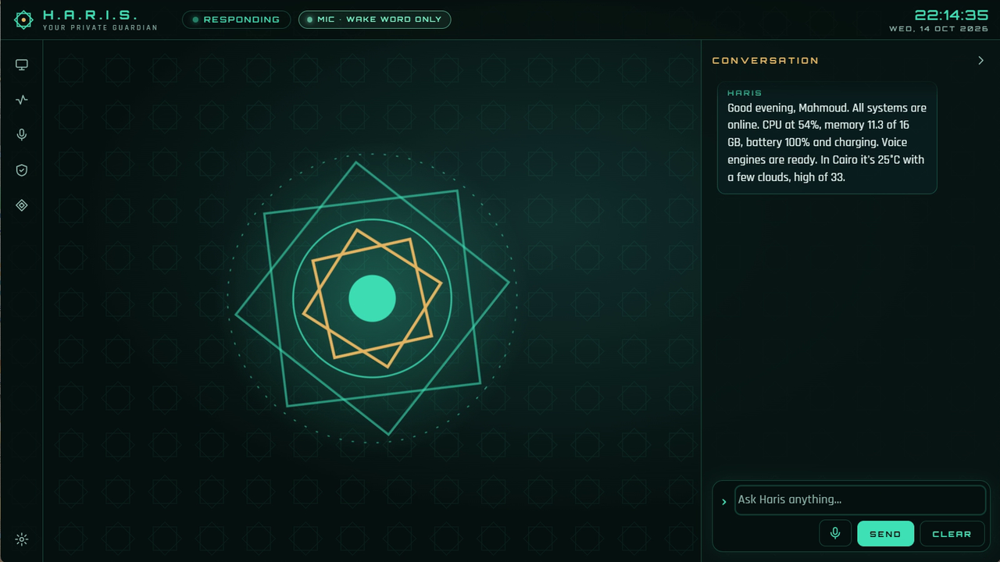

# أدلة حارس

**[English](../en/README.md)** · [ملف المشروع الرئيسي](../../../README.ar.md)

حارس (Haris) مساعد ذكي لسطح المكتب على ويندوز، والأمان فيه أولاً. يسمعك ويرد عليك وينفّذ أشياء حقيقية
على جهازك. تعمل الأدوات التي تقرأ فقط أو قليلة الخطورة وتُسجَّل، أما كل ما يفتح برنامجاً، أو يغيّر الملفات، أو يمسّ
الحافظة أو الشاشة أو الكاميرا، أو يطفئ الجهاز، فلا بد أن يمر على بطاقة موافقة أنت من يتحكم فيها. هذه الأدلة تشرح كل شيء،
من أول تشغيل حتى بناء حارس بنفسك من الكود.

## للمستخدمين

| الدليل | محتواه |
|---|---|
| [البداية](getting-started.md) | المتطلبات، وتثبيت ملف الإصدار، وأول تشغيل، واختيار المحرك، وأول محادثة، وإزالة التثبيت. |
| [المحركات](engines.md) | ‏Claude وOllama وLM Studio والسحابات المتوافقة مع OpenAI وOllama على Google Colab: الإعداد، وأين تذهب بياناتك، ونصائح اختيار النموذج، وإعداد مستوى التفكير. |
| [الصوت](voice.md) | إعداد Docker، و"Hey Haris"، والضغط للتحدث، ووضع المحادثة، واللغات، وأصوات Piper وGemini، وتحويل الكلام إلى نص على كارت NVIDIA، والسرعة المتوقعة. |
| [استخدام حارس](using-haris.md) | جولة في الواجهة، وكل ما يمكنك طلبه، وطريقة عمل الموافقات، وتقرير الحالة والملخص اليومي، واختصارات لوحة المفاتيح. |
| [الإعدادات](settings.md) | كل خانة في نافذة الإعدادات: وظيفتها، وقيمتها الافتراضية، والقيم المسموحة. |
| [الأمان والخصوصية](security-and-privacy.md) | نموذج الأمان بكلام بسيط، وما الذي يخرج من جهازك، وأين يحفظ حارس ملفاته، وسجل التدقيق، والإبلاغ عن ثغرة. |
| [حل المشكلات](troubleshooting.md) | مشكلات حقيقية وحلولها: Docker، والصوت، وكارت الشاشة، وحد Gemini، وColab، والنماذج، والميكروفون، ورمز الجلسة، والسجلات، وإعادة ضبط الإعدادات. |
| [أسئلة شائعة](faq.md) | إجابات قصيرة عن أكثر الأسئلة تكراراً. |

## للمطوّرين

| الدليل | محتواه |
|---|---|
| [البناء من الكود](building-from-source.md) | المتطلبات، و`run.ps1` و`package.ps1`، والاختبارات، وتنظيم المشروع، وكيف تدخل الواجهة في ملف الـ jar، وأساسيات المساهمة. |

## ملاحظات على طريقة الكتابة

- النصوص **العريضة** هي ما يظهر في البرنامج نفسه. إذا كانت الواجهة بالإنجليزية ستجدها بالإنجليزية، وإذا
  كانت بالعربية ستجد المقابل العربي، وغالباً نكتب الاثنين معاً، مثل **Settings** / **الإعدادات**.
- الأوامر والمسارات وأسماء الملفات تبقى بالإنجليزية كما هي.
- الرمز `~` يعني مجلد المستخدم الخاص بك في ويندوز، مثلاً `C:\Users\you`. يحفظ حارس بياناته في `~\.haris`.
- البرنامج المثبّت موجود في `%LOCALAPPDATA%\Programs\Haris`.
- إصدار حارس وقت كتابة هذه الأدلة هو 0.6.0 (من `pom.xml`).

