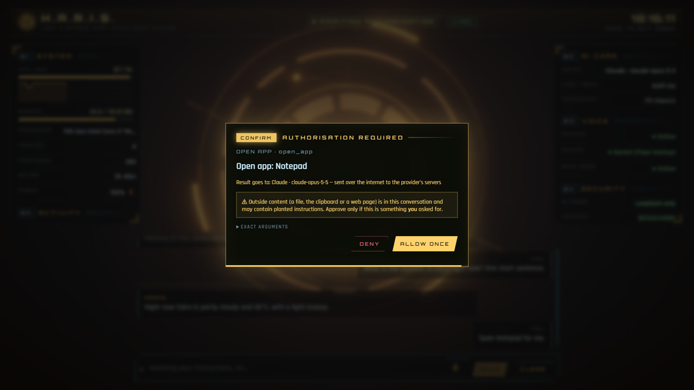

<div dir="rtl">

# البداية

**[English](../en/getting-started.md)** · [كل الأدلة](README.md)

هذا الدليل يأخذك من ملف الإصدار المضغوط حتى أول محادثة مع حارس.

## ماذا تحتاج؟

| | مطلوب؟ | السبب |
|---|---|---|
| ويندوز 10 أو 11 | نعم | حارس يستخدم مزايا ويندوز مباشرة (خزنة Credential Manager، وقائمة برامج ابدأ، وسلة المحذوفات، ومفاتيح الوسائط). |
| ‏Microsoft Edge أو Google Chrome | نعم | الواجهة تفتح كنافذة تطبيق من Edge (المفضّل) أو Chrome. |
| محرك ("العقل") | نعم | محرك محلي (Ollama أو LM Studio)، أو مفتاح API (لـ Claude أو سحابة متوافقة مع OpenAI)، أو جلسة Google Colab مجانية. راجع [المحركات](engines.md). |
| [Docker Desktop](https://www.docker.com/products/docker-desktop/) | اختياري | يشغّل تحويل الكلام إلى نص (Whisper) والصوت المنطوق (Piper) والبحث الخاص في الويب (SearXNG). بدونه تستطيع الكتابة والقراءة، وكلمة التنبيه "Hey Haris" تعمل، لكن لا شيء يحوّل كلامك إلى نص. |
| كارت شاشة NVIDIA | اختياري | تحويل أسرع للكلام إلى نص. يستخدمه حارس تلقائياً إذا وصل إليه Docker. راجع [الصوت](voice.md#التعرف-على-الكلام-بكارت-nvidia). |
| ‏Java | لا | البرنامج المثبّت يأتي ومعه بيئة Java الخاصة به. |

تحتاج اتصالاً بالإنترنت عند أول تشغيل لمحركات Docker (تنزّل صورها ونماذج الكلام مرة واحدة)، وللمحرك الذي
تختاره إلا إذا كان محلياً.

## تثبيت الإصدار

اسم ملف الإصدار `Haris-<version>-windows.zip`، ويحتوي على:

| الملف | ما هو |
|---|---|
| `Haris\` | البرنامج نفسه، ومعه بيئة Java الخاصة به ونموذج كلمة التنبيه وملفات Docker Compose. |
| `install.ps1` | يثبّت حارس لمستخدم ويندوز الحالي. |
| `uninstall.ps1` | يزيله. |
| `haris_colab.ipynb` | دفتر Colab لتشغيل المحرك على Google Colab (اختياري، راجع [المحركات](engines.md#ollama-على-google-colab)). |

1. فك ضغط الملف في أي مكان، مثلاً مجلد التنزيلات.
2. انقر بالزر الأيمن على `install.ps1` ← **Run with PowerShell**.
   إذا رفض PowerShell تشغيل السكربت، افتح PowerShell في نفس المجلد واكتب:
   `powershell -ExecutionPolicy Bypass -File install.ps1`
   وأضف `-DesktopShortcut` إذا أردت اختصاراً على سطح المكتب أيضاً.
3. شغّل **Haris** من قائمة ابدأ.

ما يفعله المثبّت:

- ينسخ البرنامج إلى `%LOCALAPPDATA%\Programs\Haris` (للمستخدم الحالي، **بدون صلاحيات مسؤول**)؛
- يتأكد أن النسخ اكتمل؛
- ينشئ اختصاراً في قائمة ابدأ (واختصاراً على سطح المكتب مع `-DesktopShortcut`)؛
- يحذف ملفات البرنامج القديم الذي كان اسمه JARVIS إن وُجد. أما بياناتك القديمة في `~\.jarvis` فينقلها حارس
  نفسه إلى `~\.haris` عند أول تشغيل.

لا يلمس المثبّت الجدار الناري (الفايرول)، ولا السجل (إلا لاحقاً إذا فعّلت *التشغيل مع ويندوز*)، ولا أي شيء
خارج ملفك الشخصي.

### الترقية

أغلق حارس، ثم شغّل `install.ps1` من الإصدار الجديد. يستبدل ملفات البرنامج فقط؛ إعداداتك وذاكرتك وتذكيراتك
ومفاتيحك في `~\.haris` وفي Credential Manager تبقى كما هي. استثناء واحد: ملف `voice\.env` الذي أنشأته داخل
مجلد البرنامج يُستبدل أيضاً، فاحتفظ بنسخة منه (راجع [الصوت](voice.md#إعدادات-صوت-متقدمة)).

## أول تشغيل

عند التشغيل يقوم حارس بالآتي:

1. يشغّل النواة على `127.0.0.1` (جهازك فقط) برمز جلسة جديد؛
2. يفتح الواجهة في نافذة تطبيق من Edge (أو Chrome) بملف تعريف متصفح خاص بها في `~\.haris\hud-profile`، فلا
   تشارك متصفحك العادي أي كوكيز أو سجل تصفح أو إضافات؛
3. يشغّل محركات الصوت والبحث في Docker إذا كان Docker Desktop يعمل (وينتظر حتى دقيقتين تقريباً ليرد Docker).

في النافذة ترى أولاً سجل إقلاع قصيراً:

<div dir="ltr">

```
H.A.R.I.S. CORE v0.6
Binding to loopback 127.0.0.1 ............ OK
Inbound network interfaces ............... NONE
Session token ............................ VERIFIED
Credential vault ......................... SEALED
Permission gate .......................... ARMED
Guardian emblem .......................... ONLINE
```

</div>

ثم تظهر الواجهة. في التثبيت الجديد لا يوجد محرك بعد، فيقول حارس:
*«أهلاً، أنا حارس. اختر محركًا من الإعدادات ونبدأ.»* (وينطقها بصوت إذا كان صوت Docker يعمل)، ويفتح لك
**الإعدادات** تلقائياً.

> في أول مرة يشغّل فيها Docker محركات الصوت، ينزّل نموذج Whisper وصوت Piper. إلى أن ينتهي التنزيل تعرض لوحة
> **الصوت** المحركات على أنها **○ متوقف**.

## اختر محركاً

في **الإعدادات** (أيقونة الترس أسفل الشريط الجانبي؛ بالإنجليزية **Settings**):

1. من **المحرك ← المزوّد** (**Engine → Provider**) اختر واحداً:

   | المزوّد | متى تستخدمه |
   |---|---|
   | **Ollama (محلي)** | عندك [Ollama](https://ollama.com) مثبّت. لا يخرج شيء من جهازك. هذا هو الافتراضي. |
   | **LM Studio (محلي)** | تستخدم الخادم المحلي في LM Studio. لا يخرج شيء من جهازك. |
   | **Ollama على Google Colab (كارت مجاني)** | جهازك أبطأ من أن يشغّل نموذجاً محلياً. يعمل على خوادم جوجل. |
   | **Claude (واجهة Anthropic)** | عندك مفتاح API من Anthropic. يتعامل مع الأدوات والصور. |
   | **سحابة متوافقة مع OpenAI** | أي مزوّد آخر بواجهة على طريقة OpenAI (عبر HTTPS). |

2. املأ الخانات التي تظهر (العنوان، النموذج، المفتاح). المفاتيح تُحفظ مباشرة في خزنة ويندوز (Credential
   Manager)، ولا تستطيع النافذة قراءتها مرة أخرى.
3. اضغط **حفظ واكتشاف النماذج** (**Save & detect models**). يحفظ حارس الإعدادات ويملأ اقتراحات خانة
   **النموذج** بما يوفّره المحرك. إذا لم يجد شيئاً يقول: *«لم يتم العثور على نماذج. هل المحرك يعمل؟»*
4. اختر النموذج واضغط **حفظ**.

التفاصيل الكاملة لكل محرك في [المحركات](engines.md).

وأنت في الإعدادات، يُستحسن أن تملأ أيضاً:

- **اسمك**: يحييك حارس باسمك الأول.
- **مدينتك (للطقس)**: تستخدمها أداة الطقس وتقرير الحالة اليومي.
- **المجلدات المسموحة**: المجلدات الوحيدة التي تراها أدوات الملفات. الافتراضي هو مجلدات سطح المكتب
  والمستندات والتنزيلات (الموجود منها).

كل خانة مشروحة في [الإعدادات](settings.md).

## أول محادثة

اكتب في الخانة أسفل الشاشة (**اسأل حارس أي شيء…**) واضغط **Enter** (و**Shift+Enter** لسطر جديد). جرّب:

- «الجو عامل إيه النهارده؟» (يعمل بدون استئذان: مجرد قراءة)
- «فاضل كام جيجا على الهارد؟»
- «افتح Notepad.» (يستأذنك أولاً)

عندما يريد حارس أن يفعل شيئاً يغيّر جهازك، تظهر بطاقة موافقة:



اقرأها، ثم اختر **رفض** أو **السماح مرة واحدة** أو **السماح لهذه الجلسة**. أزرار السماح لا تعمل إلا بعد لحظة
قصيرة، وزر **Esc** يرفض، والبطاقة ترفض من تلقاء نفسها بعد دقيقتين. التفاصيل في
[استخدام حارس](using-haris.md#الموافقات).

كل ما يفعله حارس يظهر في لوحة **النشاط**، وكثير من الأفعال يمكن التراجع عنها من هناك.

## كل يوم بعد ذلك

أول مرة تفتح فيها حارس كل يوم، يقدّم تقرير حالة قصيراً بصوته: تحية حسب وقت اليوم باسمك الأول، وحالة المعالج
والذاكرة والطاقة، وهل محركات الصوت تعمل، والطقس في مدينتك إن حددتها. التقرير مبني من قراءات حارس نفسه بدون
أي طلب للنموذج. المرات التالية في نفس اليوم تكون تحية من سطر واحد. وإذا كان **الملخص اليومي** مفعّلاً، يأتي
بعدها ملخص من النموذج في أول لحظة هدوء. راجع [استخدام حارس](using-haris.md#تقرير-الحالة-اليومي-والملخص-اليومي).

## إغلاق حارس

أغلق نافذة الواجهة. بعد نحو 20 ثانية (إعادة تحميل الصفحة لا تُحسب) تتوقف النواة وتوقف محركات Docker التي
شغّلتها. لا يبقى شيء يعمل في الخلفية، وتختفي المحادثة: المحادثات محفوظة في الذاكرة المؤقتة فقط.

## إزالة التثبيت

أغلق حارس أولاً، ثم شغّل `uninstall.ps1`، سواء من الملف المضغوط أو من `%LOCALAPPDATA%\Programs\Haris`:

| الأمر | ما يزيله |
|---|---|
| `uninstall.ps1` | البرنامج واختصاراته وإدخال *التشغيل مع ويندوز*. بياناتك تبقى في `~\.haris`. |
| `uninstall.ps1 -RemoveData` | كل ما سبق، ومعه حاويات Docker ومجلدات النماذج الخاصة بها، وكل مفتاح حفظه حارس في Credential Manager، ومجلد `~\.haris` (الإعدادات، والذاكرة، وسجل التدقيق، والتذكيرات، والسجلات، وملف تعريف متصفح الواجهة). ويحذف أيضاً مجلد `~\.jarvis` القديم إن وُجد. |

إذا منع PowerShell السكربت، استخدم `powershell -ExecutionPolicy Bypass -File uninstall.ps1` (وأضف
`-RemoveData` إن أردت).

## الخطوات التالية

- [المحركات](engines.md): اختر العقل المناسب.
- [الصوت](voice.md): كلّم حارس بصوتك.
- [استخدام حارس](using-haris.md): كل ما يمكنك طلبه.

</div>
