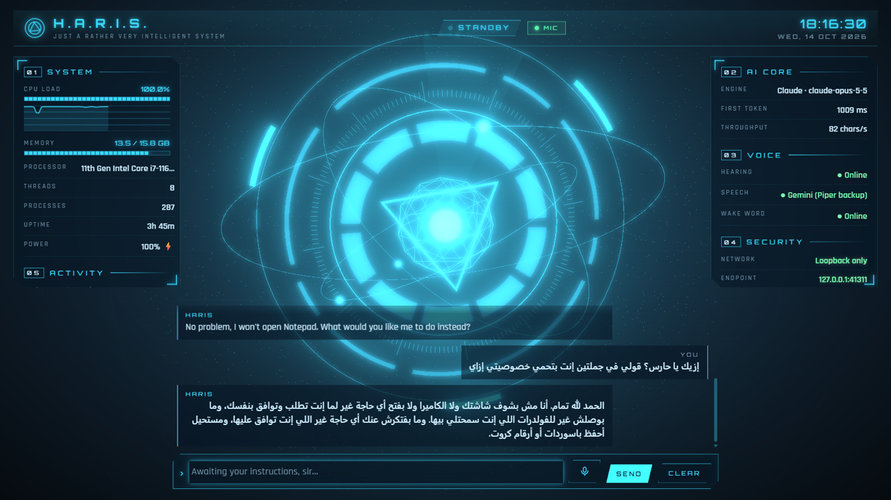
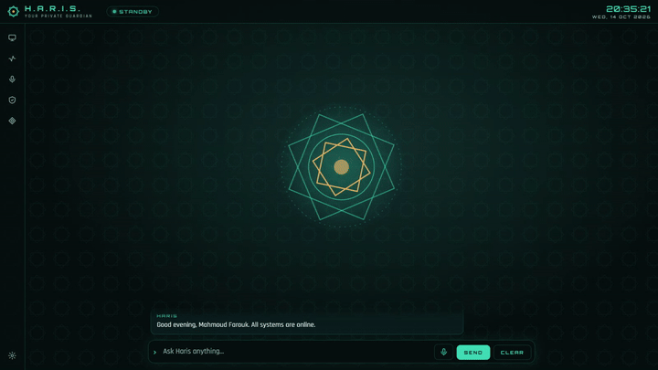

# استخدام حارس

**[English](../en/using-haris.md)** · [كل الأدلة](README.md)

جولة في الواجهة، وكل ما يمكنك أن تطلبه من حارس، وكيف تعمل الموافقات.

## الواجهة

### الشريط العلوي

| الجزء | ما يعرضه |
|---|---|
| الاسم | **حارس** و*حارسك الخاص* (بالإنجليزية **H.A.R.I.S.** و*Your private guardian*). إذا غيّرت اسم المساعد يظهر الاسم الجديد، وإذا كان كلمة لاتينية واحدة يُكتب بنقاط. |
| شارة الحالة | ما يفعله حارس الآن (الجدول التالي). |
| شارة **الميكروفون** | تظهر طالما الميكروفون مفتوح: **الميكروفون** أو **يسجّل** أو **الميكروفون · كلمة التنبيه فقط**. |
| شارة **الكاميرا تعمل** | تظهر أثناء تشغيل الكاميرا لصورة وافقت عليها. |
| الساعة | الوقت والتاريخ المحليان. |

| شارة الحالة (عربي / إنجليزي) | المعنى |
|---|---|
| **جاهز** / **STANDBY** | لا شيء يحدث. |
| **يستمع** / **LISTENING** | يسجّل صوتك. |
| **يحوّل الكلام إلى نص** / **TRANSCRIBING** | يحوّل التسجيل إلى نص. |
| **يفكّر** / **PROCESSING** | ينتظر النموذج. |
| **يرد** / **RESPONDING** | يكتب الرد أو ينطقه. |
| **ينفّذ** / **EXECUTING** | يشغّل أداة. |
| **بانتظار إذنك** / **AWAITING AUTHORISATION** | بطاقة موافقة مفتوحة. |
| **خطأ** / **FAULT** | حدث خطأ؛ الرسالة تشرحه. يعود إلى **جاهز** بعد ثوانٍ. |

### الشعار

النجمة الثمانية في المنتصف تعكس الحالة:

| الحالة | شكل الشعار |
|---|---|
| جاهز | طبقتا النجمة تدوران ببطء في اتجاهين متعاكسين حول القلب الذهبي. |
| يستمع | حلقة تنبض للخارج، والقلب يصبح أخضر زمردياً. |
| يفكّر / يحوّل الكلام / ينفّذ | الطبقة الداخلية تدور أسرع، والنجمة الخارجية تصبح ذهبية. |
| يرد بصوت | القلب يكبر ويصغر مع صوت حارس. |
| بانتظار إذنك | تتوقف الحركة ويصبح الشعار كله ذهبياً. |
| خطأ | تتوقف الحركة ويصبح الشعار أحمر. |

إذا طلب ويندوز من البرامج تقليل الحركة، يُختصر عرض الإقلاع.

### الشريط الجانبي واللوحات

الشريط الجانبي (على اليمين في الواجهة العربية، وعلى اليسار في الإنجليزية) يفتح:

| الأيقونة | تفتح | المحتوى |
|---|---|---|
| شاشة | لوحة **النظام** | حمل المعالج مع رسم لآخر دقيقتين، والذاكرة، والمعالج، والخيوط، والعمليات، ومدة التشغيل، والطاقة؛ و**محرك الذكاء**: المحرك، وزمن أول استجابة، وسرعة الرد الأخير. |
| خط نبض | لوحة **النشاط** | آخر ستة أفعال وزر **↶ تراجع**. |
| ميكروفون | لوحة **الصوت** | حالة **السمع** و**النطق** و**كلمة التنبيه**. راجع [الصوت](voice.md). |
| درع | لوحة **الأمان** | حالة الأمان (بالأسفل). |
| معيّن | نافذة **الذاكرة** | ما يتذكره حارس عنك. |
| ترس (بالأسفل) | نافذة **الإعدادات** | راجع [الإعدادات](settings.md). |

سلوك اللوحات يعتمد على عرض النافذة:

- **أقل من 1200 بكسل:** اللوحة تطفو فوق المساحة الرئيسية، والنقر خارجها يغلقها.
- **من 1200 بكسل فأكثر:** اللوحة المفتوحة تُثبَّت في مكانها وتزيح المساحة الرئيسية جانباً، لذلك النقر خارجها لا
  يغلقها. أغلقها بأيقونتها في الشريط، أو بزر **✕**، أو بـ **Esc**.
- **من 1600 بكسل فأكثر:** يظهر زر **تثبيت اللوحة** في رأس اللوحة. اللوحة المثبّتة تُفتح وحدها في التشغيل
  التالي (عندما تكون النافذة عريضة بما يكفي).

لوحة واحدة فقط تُفتح في كل مرة. نقطة ذهبية على أيقونة النشاط أو الأمان تعني أن شيئاً جديداً حدث داخل لوحة
مغلقة.

### عمود المحادثة ووضع الصوت

- **أقل من 1200 بكسل:** المحادثة أسفل الشعار ومرئية دائماً.
- **من 1200 بكسل فأكثر:** المحادثة عمود بطول النافذة. زر **إخفاء المحادثة** يخفيها: هذا هو *وضع الصوت*. لا
  يبقى إلا خانة الكتابة، طافية أسفل الشعار. لسان **المحادثة** على الحافة يعيدها، ويحمل نقطة ذهبية إذا وصلت
  رسالة جديدة وهي مخفية. حارس يتذكر اختيارك.

داخل المحادثة:

- رسائلك عنوانها **أنت**، ورسائل حارس عنوانها اسمه، والتنبيهات والأخطاء **النظام**، والتذكيرات **تذكير**.
- سطور الأدوات تبيّن ما يعمل: **⟳** يعمل، **✓** تم، **✕** مرفوض، **!** خطأ.
- كل صورة تُشارك مع النموذج تظهر في المحادثة بعنوان **تمت مشاركتها مع النموذج**.
- رد النموذج يُعرض نصاً عادياً فقط، وليس HTML أبداً.

أسفل المحادثة: خانة الكتابة (حتى 8,000 حرف)، وزر الميكروفون، و**إرسال**، و**مسح** (*انسَ هذه المحادثة*)
الذي يبدأ محادثة جديدة ويرفض أي شيء ما زال ينتظر الموافقة.

### لوحة النشاط والتراجع

كل فعل من آخر ستة أفعال يظهر بأيقونة:

| الأيقونة | القرار |
|---|---|
| ◇ | نُفّذ بدون استئذان (آمن) |
| ◆ | نُفّذ بموافقة "السماح لهذه الجلسة" |
| ✓ | أنت وافقت |
| ✕ | رُفض (منك، أو بـ Esc، أو بانتهاء الوقت) |
| ↶ | شيء فعلته أنت (تراجع، حذف من الذاكرة، التشغيل التلقائي) |

مرّر المؤشر على أي سطر لترى اسم الأداة، والخطورة، والقرار، والنتيجة، والوقت. التاريخ الكامل في سجل التدقيق
`~\.haris\audit.jsonl` (راجع [الأمان والخصوصية](security-and-privacy.md#سجل-التدقيق)).

زر **↶ تراجع** يلغي آخر فعل قابل للتراجع، والسطر أسفله يقول ما التالي (*التراجع التالي: …*). يحتفظ حارس بحد
أقصى 25 خطوة تراجع، في الذاكرة فقط (تضيع بعد إعادة التشغيل).

| الفعل | ما يفعله التراجع |
|---|---|
| رفع الصوت / خفضه | يعيد مستوى الصوت. |
| إعادة التشغيل / إيقاف التشغيل | يلغيه (طالما العد التنازلي 60 ثانية مستمر). |
| إضافة تذكير | يلغيه. |
| إنشاء ملف | يحذفه. |
| الكتابة فوق ملف / الإضافة إليه | يعيد المحتوى السابق. |
| إنشاء مجلد | يحذفه، بشرط أن يكون ما زال فارغاً. |
| نقل / إعادة تسمية | يعيده لمكانه، إذا كان المكان القديم ما زال فارغاً. |
| النسخ إلى الحافظة | يعيد نص الحافظة السابق. |
| تذكّر معلومة | ينساها. |
| نسيان معلومة | يتذكرها من جديد. |

حذف الملف لا يُلغى من حارس: الملف ذهب إلى سلة المحذوفات، فاسترجعه من هناك.

### لوحة الأمان

| الصف | ما يعرضه |
|---|---|
| **الشبكة** | **هذا الجهاز فقط**: النواة تستمع على `127.0.0.1` ولا شيء غيره. |
| **العنوان** | العنوان المحلي، مثلاً `127.0.0.1:48213`. |
| **الجلسة** | **الرمز موثَّق**، أو **غير مصرَّح** إذا كانت النافذة بلا رمز جلسة. |
| **المفاتيح** | **خزنة النظام**: المفاتيح في Credential Manager. |
| **الأدوات** | **25 مسموح بها**: مجموعة الأدوات الثابتة. |
| **السياق** | **نظيف**، أو **محتوى خارجي** بمجرد أن يدخل المحادثة نص من الخارج (ملف، أو الحافظة، أو صفحة ويب، أو لقطة شاشة، أو أسماء ملفات أو برامج). راجع [المحتوى الخارجي](#المحتوى-الخارجي). |

### نافذة الذاكرة

كل ما يتذكره حارس عنك، الأحدث أولاً، ومع كل معلومة تصنيفها (`preference` أو `person` أو `project` أو
`routine` أو `fact`). مرّر المؤشر على المعلومة لترى متى حُفظت. زر **✕** ينسى معلومة واحدة فوراً، وزر
**انسَ كل شيء** يمسح الكل بعد تأكيد. المعلومات مشفّرة على جهازك (راجع
[الأمان والخصوصية](security-and-privacy.md#تشفير-الذاكرة)).

## ما الذي يمكنك طلبه

لدى حارس 25 أداة. لكل أداة مستوى خطورة ثابت يحدد هل تستأذنك أولاً:

- **آمن**: تعمل بدون استئذان، وتُسجَّل.
- **تأكيد**: تستأذنك ببطاقة موافقة؛ يمكنك السماح مرة واحدة، أو لبعض الأدوات السماح طوال الجلسة.
- **حرج**: تستأذنك في كل مرة.

### البرامج والوسائط والطاقة

| مثال على الطلب | الأداة | الخطورة | ملاحظات |
|---|---|---|---|
| «عندي إيه برامج لتعديل الصور؟» | `list_apps` | آمن | يقرأ قائمة ابدأ. |
| «افتح Spotify.» | `open_app` | تأكيد | البرامج الموجودة في قائمة ابدأ فقط، بالاسم. إذا تطابق أكثر من برنامج يسألك حارس أيها تقصد. |
| «دوّر على يوتيوب على دروس عود.» · «افتح github.com.» | `open_url` | تأكيد | يفتح متصفحك الافتراضي. البحث على Google (الافتراضي) أو YouTube أو Bing أو DuckDuckGo أو Maps. روابط `http(s)` فقط؛ الروابط التي فيها اسم مستخدم أو كلمة سر تُرفض. |
| «وطّي الصوت شوية.» · «الأغنية اللي بعدها.» · «اكتم الصوت.» | `media_control` | آمن | خطوات صوت بنحو 2%؛ تشغيل/إيقاف مؤقت، التالي، السابق، كتم. |
| «اقفل الجهاز.» | `power` | تأكيد، في كل مرة | |
| «خلّي الجهاز ينام.» · «اعمل ريستارت.» · «اقفل الكمبيوتر.» | `power` | حرج | إعادة التشغيل والإيقاف تنتظران 60 ثانية ويمكن إلغاؤهما (بالتراجع، أو بالأمر `shutdown /a`). |
| «الغي الإيقاف.» | `power` | آمن | |
| «البطارية عاملة إيه؟» · «فاضل كام جيجا على الهارد؟» | `system_status` | آمن | المعالج، والذاكرة، والبطارية، ومدة التشغيل، والمساحة الحرة. |

### الملفات (داخل المجلدات المسموحة فقط)

| مثال على الطلب | الأداة | الخطورة | ملاحظات |
|---|---|---|---|
| «إيه اللي في التنزيلات؟» | `list_folder` | آمن | حتى 200 عنصر؛ الملفات المخفية لا تظهر. |
| «دوّر على ملفات الفواتير PDF.» | `search_files` | آمن | يبحث في أسماء الملفات، حتى 50 نتيجة. |
| «لخّص notes.txt اللي على سطح المكتب.» | `read_file` | آمن | ملفات نصية حتى 256 KB. |
| «احفظ القائمة دي في shopping.md في المستندات.» | `write_file` | تأكيد | أنواع نصية فقط: `.txt .md .markdown .csv .tsv .json .log .yaml .yml .xml .srt`. إنشاء (لا يكتب فوق ملف موجود)، أو كتابة فوق ملف، أو إضافة إليه. |
| «اعمل فولدر اسمه Trips في المستندات.» | `create_folder` | تأكيد | |
| «انقل report.txt لسطح المكتب.» · «غيّر اسمه لـ final.txt.» | `move_file` | تأكيد | لا يكتب فوق ملف موجود أبداً؛ وإعادة التسمية لا تغيّر نوع الملف. |
| «امسح old-draft.txt.» | `delete_file` | حرج | ينقله إلى سلة المحذوفات. لا يمكن حذف المجلدات المسموحة نفسها. |

أدوات الملفات لا تلمس الأسرار أبداً (ملفات `.env`، والمفاتيح، وقواعد كلمات السر `.kdbx`، وأي ملف اسمه يوحي
بكلمة سر أو بيانات دخول، ومجلدات مثل `.ssh`)، ولا تعدّل الملفات المخفية، ولا تنشئ أو تعيد تسمية أي شيء إلى
نوع يشغّله ويندوز. التفاصيل في [الأمان والخصوصية](security-and-privacy.md#الملفات).

### الحافظة والرسائل والتذكيرات والطقس

| مثال على الطلب | الأداة | الخطورة | ملاحظات |
|---|---|---|---|
| «ترجم اللي نسخته.» · «صحّح القواعد في اللي في الحافظة.» | `clipboard_read` | تأكيد، في كل مرة | الحافظة قد تحتوي أي شيء خاص. |
| «حط النسخة المصححة في الحافظة.» | `clipboard_write` | تأكيد | التراجع يعيد النص السابق. |
| «اكتب رسالة واتساب لـ +20 100 000 0000 إني متأخر.» · «اكتب إيميل لـ sara@example.com.» | `compose_message` | تأكيد | يفتح مسودة في WhatsApp أو Telegram أو برنامج البريد. **أنت** من يضغط إرسال؛ حارس لا يستطيع الإرسال. |
| «فكّرني بعد 20 دقيقة أكلم ماما.» · «عندي تذكيرات إيه؟» | `reminders` | آمن | إضافة أو عرض أو إلغاء. يظهر التذكير في المحادثة وكإشعار من ويندوز طالما حارس يعمل؛ والتذكير الذي فات بأقل من ساعة يُعرض في التشغيل التالي. |
| «الجو عامل إيه في إسكندرية؟» | `weather` | آمن | الطقس الحالي وتوقعات 3 أيام من Open-Meteo؛ ومدينتك إن لم تذكر مدينة. |

### الويب

| مثال على الطلب | الأداة | الخطورة | ملاحظات |
|---|---|---|---|
| «إيه آخر أخبار كأس العالم؟» | `web_search` | آمن | عبر محرك SearXNG المحلي (يحتاج Docker). |
| «اقرا المقال ده ولخّصه.» | `fetch_page` | آمن | الصفحات العامة فقط (لا شبكة محلية، منافذ قياسية فقط)؛ تُحذف العناصر المخفية؛ حتى 15,000 حرف من النص. |

### الرؤية

| مثال على الطلب | الأداة | الخطورة | ملاحظات |
|---|---|---|---|
| «إيه الخطأ اللي على الشاشة ده؟» | `look_at_screen` | تأكيد، في كل مرة | يصغّر حارس نافذته، ويلتقط صورة شاشة **واحدة** (الشاشة الرئيسية أو كل الشاشات)، ويعرض لك **نفس الصورة بالضبط** على بطاقة الموافقة قبل مشاركة أي شيء. |
| «أنا ماسك إيه في إيدي؟» | `look_through_camera` | تأكيد، في كل مرة | بعد موافقتك تعمل الكاميرا نحو ثانية لصورة **واحدة** (تظهر شارة **الكاميرا تعمل**)، ثم تُغلق. الصورة تظهر في المحادثة. وعلى عكس لقطة الشاشة، لا تُعرض قبل إرسالها. |

تُصغَّر الصور بحيث لا يزيد ضلعها الأطول عن 1568 بكسل ويُعاد ترميزها، فتُحذف منها البيانات الوصفية مثل الموقع.
مع محرك محلي أو Colab تحتاج نموذج رؤية (راجع [المحركات](engines.md#اختيار-النموذج)).

### الذاكرة

| مثال على الطلب | الأداة | الخطورة | ملاحظات |
|---|---|---|---|
| «افتكر إن عيد ميلاد أختي 3 مايو.» | `remember` | تأكيد | معلومة واحدة قصيرة. كلمات السر والأكواد والمفاتيح وأرقام البطاقات والحسابات تُرفض. |
| «تعرف إيه عن مشاريعي؟» | `recall` | آمن | يبحث في المعلومات الأقدم. |
| «انسَ عنواني القديم.» | `forget` | تأكيد | |

قد *يعرض* عليك حارس أن يتذكر شيئاً، لكنه يحتاج موافقتك في كل الأحوال.

### ما لا يستطيع حارس فعله

- تشغيل برامج غير برامج قائمة ابدأ، أو سكربتات، أو كود، أو أوامر shell. لا توجد أداة لذلك أصلاً.
- إرسال رسالة: هو يفتح مسودات فقط.
- رؤية شاشتك أو الكاميرا بدون طلب وموافقة على كل صورة.
- لمس ملفات خارج المجلدات التي سمحت بها.

في الطلب الواحد يستطيع حارس تنفيذ 12 خطوة أدوات على الأكثر، ثم يتوقف ويقول *"I stopped after 12 steps to stay
on the safe side. Ask me to continue if needed."*

## الموافقات

عندما يأتي فعل من مستوى **تأكيد** أو **حرج**، يتوقف حارس (الحالة **بانتظار إذنك**) ويعرض بطاقة:

| جزء البطاقة | ما يخبرك به |
|---|---|
| شارة **تأكيد** أو **حرج** | مستوى الخطورة. |
| **مطلوب إذنك** | العنوان. |
| سطر الأداة | اسم الأداة الظاهر واسمها البرمجي، مثلاً `فتح برنامج · open_app`. |
| الملخص | ما سيحدث بالضبط، مثلاً *Open app: Spotify* أو *RESTART the computer in 60 seconds*. |
| الصورة | في لقطة الشاشة: نفس الصورة التي ستُشارك بالضبط. |
| *النتيجة تذهب إلى: …* | أي محرك سيرى النتيجة، وهل تبقى على الجهاز أم تذهب عبر الإنترنت. |
| تحذير | يظهر عندما يكون في المحادثة محتوى خارجي (بالأسفل). |
| **المعاملات بالتفصيل** | افتحها لترى المعاملات الدقيقة التي أرسلها النموذج. |
| شريط الوقت | دقيقتان. |

اختياراتك:

| الزر | النتيجة |
|---|---|
| **رفض** | لا شيء يُنفَّذ، ويُطلب من النموذج ألا يكرر المحاولة. التركيز يكون على زر **رفض**. |
| **السماح مرة واحدة** | يُنفَّذ هذا الفعل مرة واحدة. |
| **السماح لهذه الجلسة** | يُنفَّذ، وتعمل هذه الأداة بعد ذلك بدون استئذان حتى نهاية المحادثة. |

قواعد تحمي الموافقات:

- أزرار السماح لا تعمل إلا بعد 0.7 ثانية، حتى لا توافق نقرة عابرة أو ضغطة Enter على شيء لم تقرأه.
- **Esc** يرفض. وإغلاق النافذة أو مرور دقيقتين يرفض أيضاً.
- الموافقة لا تأتي إلا من نقرة في الواجهة. لا يمكن الموافقة بالصوت (فيديو يعمل بجوارك قد يقول "allow").
- **السماح لهذه الجلسة** لا يُعرض إلا لأدوات التأكيد، ولا يُعرض أبداً لقراءة الحافظة أو لقطات الشاشة أو صور
  الكاميرا أو أفعال الطاقة أو الحذف. والأفعال الحرجة تستأذن في كل مرة.
- موافقة الجلسة تستمر حتى تبدأ المحادثة من جديد: بزر **مسح**، أو بتغيير الإعدادات، أو بإغلاق حارس، أو عندما
  تطول المحادثة جداً.

### إيقاف الرد

أثناء رد حارس يتحول زر **إرسال** إلى **إيقاف**. اضغطه لإنهاء الرد: تُعدّ بطاقة الموافقة المفتوحة **رفضاً**، ولا
يُنفَّذ أي شيء آخر لهذه الرسالة، أما الأداة التي تعمل بالفعل فتكمل عملها (فلا يبقى ملف مكتوب نصفه). الضغط على
Enter لا يوقف الرد أبداً؛ الزر وحده يفعل. بعدها تُنسى الرسالة، وكل ما نُفّذ قبل الإيقاف موجود في لوحة النشاط.

### المحتوى الخارجي

النص الذي لم يأتِ منك (الملفات، والحافظة، وصفحات الويب ونتائج البحث، ولقطات الشاشة والصور، وأسماء الملفات
والبرامج، وأسماء أماكن الطقس) قد يحتوي تعليمات مزروعة. بمجرد أن يدخل شيء منه المحادثة:

- صف **السياق** في لوحة الأمان يعرض **محتوى خارجي**؛
- موافقة **السماح لهذه الجلسة** تتوقف عن العمل ولا تُعرض بعد ذلك: كل فعل تأكيد يستأذن من جديد؛
- الأفعال التي ترسل بيانات للخارج (البحث، وقراءة صفحة، والطقس) تستأذن أيضاً، مع أنها آمنة في العادة، حتى ترى
  البحث أو العنوان بالضبط؛
- بطاقة الموافقة تعرض: *«⚠ في هذه المحادثة محتوى خارجي (ملف أو الحافظة أو صفحة ويب) وقد يحتوي تعليمات مزروعة.
  وافق فقط إذا كان هذا شيئًا طلبته أنت.»*

زر **مسح** يبدأ محادثة نظيفة.

## تقرير الحالة اليومي والملخص اليومي

**تقرير الحالة (أول تشغيل في اليوم).** ينطق حارس ويعرض تقريراً بلغة الواجهة، مبنياً من قراءاته الخاصة بدون
أي طلب للنموذج:

> *صباح الخير يا سارة. كل الأنظمة تعمل. استهلاك المعالج 12%، والذاكرة 7.9 من 16 جيجابايت، والبطارية 80%
> وتُشحن. محركات الصوت جاهزة. في القاهرة الآن 24°C، سماء صافية، والعظمى اليوم 31°C.*

ينتظر بضع ثوانٍ حتى تبدأ محركات الصوت، ويستخدم اسمك الأول (الأسماء المركبة مثل «عبد الرحمن» تبقى كاملة،
والألقاب مثل «د.» تُتجاوز)، أو «يا فندم» / "sir" إذا لم تكتب اسماً، ويتجاهل الطقس إذا لم تحدد مدينة. إذا كان
أحد محركات الصوت متوقفاً يقول ذلك، مثلاً *«التعرّف على الكلام متوقف — هل Docker Desktop يعمل؟»*. وفي المرات
التالية من نفس اليوم يكتفي بتحية قصيرة: *«مساء الخير يا سارة. كل الأنظمة تعمل.»*

**الملخص اليومي** (**الإعدادات ← الهوية ← ملخّص يومي عند أول تشغيل في اليوم**، مفعّل افتراضياً). مرة في اليوم،
في أول لحظة هدوء (بعد تقرير الحالة، وأبداً أثناء طلب لك)، يرسل حارس إلى النموذج طلباً بعنوان
**☀ الملخّص اليومي**: تحية، وتاريخ اليوم، وتذكيرات اليوم، وثلاثة عناوين أخبار من بحث واحد في الويب، وأي شيء
من الذاكرة يهمك اليوم، في أقل من 120 كلمة. هذا يستخدم المحرك، فمع محرك سحابي يكون طلباً سحابياً عادياً. ينتظر
الملخص حتى يكون هناك محرك جاهز، وإذا كنت مشغولاً بالحديث مع حارس ينتظر فترة هدوء أطول.

## اختصارات لوحة المفاتيح

| المفاتيح | أين | الوظيفة |
|---|---|---|
| **Enter** | خانة الكتابة | إرسال. |
| **Shift+Enter** | خانة الكتابة | سطر جديد. |
| **Ctrl+Space** (ضغط مطوّل) | في أي مكان داخل النافذة | اضغط وتحدث: يسجّل طالما المفتاحان مضغوطان. ويوقف كلام حارس أيضاً. |
| **Esc** | بطاقة الموافقة | رفض. |
| **Esc** | لوحة مفتوحة | إغلاقها (ويعود التركيز إلى أيقونتها). |
| **Tab** | بطاقة الموافقة | التنقل بين **رفض** (عليه التركيز أولاً) و**السماح لهذه الجلسة** و**السماح مرة واحدة**. |

