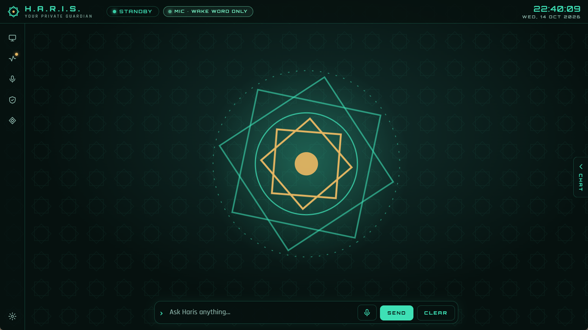

# الصوت

**[English](../en/voice.md)** · [كل الأدلة](README.md)

يستطيع حارس أن ينتظر كلمة التنبيه "Hey Haris"، وأن يحوّل كلامك إلى نص، وأن ينطق ردوده جملة بجملة. كل ذلك يعمل
على جهازك، ما عدا صوت Gemini الاختياري.

## محركات الصوت

| المحرك | يعمل في | وظيفته |
|---|---|---|
| ‏Vosk مع `vosk-model-small-en-us-0.15` | داخل حارس | كلمة التنبيه. بلا حاوية وبلا شبكة. |
| ‏Whisper | ‏Docker على `127.0.0.1:10300`؛ على كارت NVIDIA إن وُجد، وإلا على المعالج | تحويل الكلام إلى نص، بالعربية والإنجليزية. |
| ‏Piper | ‏Docker على `127.0.0.1:10200` | تحويل النص إلى كلام. الأصوات الافتراضية `en_GB-alan-medium` و`ar_JO-kareem-medium`. |
| ‏Gemini *(اختياري)* | جوجل، بمفتاحك الخاص | صوت طبيعي، بما في ذلك اللهجة المصرية. ‏Piper يتولى إذا فشل. |
| ‏faster-whisper على Colab *(اختياري)* | جلسة Colab الخاصة بك | تحويل الكلام إلى نص عند استخدام محرك Colab. راجع [المحركات](engines.md#التعرف-على-الكلام-على-colab). |

لوحة **الصوت** (أيقونة الميكروفون في الشريط الجانبي؛ بالإنجليزية **Voice**) تعرض كل محرك: **السمع**
و**النطق** و**كلمة التنبيه**، وكلٌّ منها **● يعمل** أو **○ متوقف**، إضافة إلى الحالات الموضحة بالأسفل.

## إعداد Docker

1. ثبّت [Docker Desktop](https://www.docker.com/products/docker-desktop/) وشغّله.
2. شغّل حارس. سيشغّل `docker compose` على `voice/compose.yaml` و`search/compose.yaml` (النسختين الموجودتين
   بجوار `Haris.exe`، أو في مجلد المشروع عند التشغيل من الكود).
3. أول تشغيل ينزّل الصور ونموذج Whisper وصوت Piper. هذا يحتاج إنترنت ويأخذ بعض الوقت، والمحركات تظهر
   **○ متوقف** حتى تجهز.

معلومات مفيدة:

- ينتظر حارس حتى دقيقتين تقريباً ليرد Docker عند التشغيل. إذا شغّلت Docker بعد ذلك، أعد تشغيل حارس حتى يشغّل
  المحركات.
- الحاويات تبدأ مع حارس وتتوقف عند إغلاقه، فلا يبقى محرك ميكروفون يعمل بدونه.
- الحاويات مقوّاة أمنياً: منافذها على `127.0.0.1` فقط، ونظام ملفاتها للقراءة فقط، وكل صلاحيات لينكس مسحوبة،
  ولا رفع للصلاحيات، وحدود للذاكرة والمعالج، وإصدارات صور مثبّتة.
- بدون Docker تستطيع الكتابة، وكلمة التنبيه تعمل، لكن كلامك لا يُحوَّل إلى نص (إلا مع
  [التعرف على الكلام على Colab](engines.md#التعرف-على-الكلام-على-colab))، وPiper لا يستطيع النطق (صوت Gemini يستطيع).

## طرق التحدث

| الطريقة | ما يحدث |
|---|---|
| **اضغط Ctrl+Space مطوّلاً** (اضغط وتحدث) | يسجّل طالما المفتاحان مضغوطان، في أي مكان داخل نافذة حارس. اتركهما للإرسال. |
| **انقر الميكروفون** بجوار **إرسال** | يسجّل حتى تتوقف عن الكلام. انقره مرة أخرى للإيقاف مبكراً. |
| **قل "Hey Haris"** | يحتاج تفعيل كلمة التنبيه (بالأسفل). نغمة قصيرة من نبرتين تعني أن حارس يستمع. |

في المرة الأولى يطلب المتصفح إذن استخدام الميكروفون. حارس يحافظ على نفس المنفذ المحلي بين مرات التشغيل، لذلك
يُحفظ الإذن.

أثناء التسجيل:

- تظهر الحالة **يستمع** ثم **يحوّل الكلام إلى نص**؛
- ينتهي التسجيل بعد نحو 0.6 ثانية من الصمت بعد أن تتكلم، ويُلغى إذا لم يتكلم أحد خلال 5 ثوانٍ، ولا يتجاوز
  15 ثانية؛
- التسجيلات التي ليس فيها كلام حقيقي (صمت، نقرات، ضوضاء الغرفة) تُستبعد قبل أن تصل إلى Whisper؛
- الصوت يبقى في الذاكرة فقط أثناء الطلب، ولا يُكتب على القرص أبداً.

شارة **الميكروفون** في الشريط العلوي تظهر طالما الميكروفون مفتوح. تكتب **يسجّل** أثناء التسجيل،
و**الميكروفون · كلمة التنبيه فقط** عندما لا يستمع إلا محرك كلمة التنبيه.

**المقاطعة:** ابدأ الكلام (Ctrl+Space أو زر الميكروفون) وحارس يتكلم، فيسكت فوراً.

## كلمة التنبيه

فعّلها من **الإعدادات ← الصوت ← استمع لـ "Hey Haris"** (مغلقة افتراضياً).

- قل تحية يليها الاسم مباشرة: **"Hey Haris"**، وأيضاً "Hi" أو "Okay" أو "OK" أو "Ya" أو "Yeah" + "Haris".
  الاسم وحده لا يوقظه، لأن "Harris" اسم عائلة شائع في التلفزيون والأخبار.
- الميكروفون يبقى مفتوحاً، لكن صوته يذهب فقط إلى محرك كلمة التنبيه داخل حارس، والذي لا يحلل الصوت إلا عندما
  يتكلم أحد. لا شيء يُسجَّل أو يُرسَل.
- لا يستمع حارس لكلمة التنبيه وهو يتكلم، حتى لا يوقظ نفسه.
- كلمة التنبيه دائماً "Hey Haris"، حتى لو غيّرت اسم المساعد.
- إذا رفض المتصفح الميكروفون، يقول حارس *«تم رفض الوصول للميكروفون، لذلك كلمة التنبيه متوقفة.»*

صف **كلمة التنبيه** في لوحة الصوت يعرض **● يعمل** عندما تعمل، و**○ نموذج "hey haris" غير موجود** إذا كان
نموذج كلمة التنبيه ناقصاً.

## وضع المحادثة

**الإعدادات ← الصوت ← وضع المحادثة** (مفعّل افتراضياً): بعد أن يرد حارس بصوته على طلب *منطوق*، يصدر نغمة
ويستمع 5 ثوانٍ لسؤال تالٍ بدون كلمة التنبيه. الصمت ينهي المحادثة. الطلبات المكتوبة لا تشغّل هذا الوضع.

## الردود المنطوقة

**الإعدادات ← الصوت ← انطق الردود بصوت** (مفعّل افتراضياً). يبدأ حارس الكلام والرد ما زال يُكتب: أول كلمات
تخرج عند أول وقفة مناسبة، ثم جملة بجملة. رموز Markdown لا تُقرأ، والروابط تُنطق كلمة "link"، وكتل الكود تصبح
"(code omitted)".

إذا لم تكن قد نقرت داخل النافذة بعد ومنع المتصفح الصوت، يطلب منك حارس أن تنقر في أي مكان في النافذة مرة واحدة.

## اللغات: ما تتحدث به، وما يرد به حارس، وما تعرضه الواجهة

ثلاثة إعدادات منفصلة:

| الإعداد | القيم | يؤثر على |
|---|---|---|
| **أتحدث** (`sttLanguage`) | **اكتشاف تلقائي**، **العربية (الأفضل للهجة المصرية)**، **الإنجليزية** | اللغة التي يتوقعها Whisper. اختر العربية إذا كنت تتكلم بالمصري. |
| **حارس يرد بـ** (`replyLanguage`) | **اللغة التي أستخدمها**، **العربية المصرية دائمًا**، **الإنجليزية دائمًا** | لغة الرد التي يُطلب من النموذج استخدامها. الردود العربية تكون باللهجة المصرية. |
| **لغة الواجهة** (`uiLanguage`) | **English**، **العربية** | كلمات الواجهة نفسها واتجاهها (العربية من اليمين لليسار)، ولغة التحية وتقرير الحالة. |

مثلاً، يمكنك ترك الواجهة بالإنجليزية وجعل حارس يرد دائماً بالمصري.

## أصوات Piper

| الإعداد | الافتراضي |
|---|---|
| **صوت Piper الإنجليزي** | `en_GB-alan-medium` |
| **صوت Piper العربي** | `ar_JO-kareem-medium` |

يستخدم حارس الصوت العربي لأي جملة فيها حروف عربية، والصوت الإنجليزي لغيرها. أي اسم صوت من Piper على الشكل
`xx_YY-name-quality` (والجودة `x_low` أو `low` أو `medium` أو `high`) مقبول، وPiper ينزّل الصوت الجديد أول مرة
يُستخدم فيها. راجع رخصة كل صوت قبل الاستخدام التجاري (في [THIRD_PARTY_NOTICES.md](../../../THIRD_PARTY_NOTICES.md)).

زر **▶ اختبار السماعة** في الإعدادات يشغّل جملة اختبار بالإنجليزية وأخرى بالعربية.

## صوت Gemini

صوت أكثر طبيعية، بما في ذلك اللهجة المصرية، من خدمة تحويل النص إلى كلام في Gemini من جوجل
(`gemini-3.8-flash-tts`).

1. احصل على مفتاح من [aistudio.google.com](https://aistudio.google.com) ← **Get API key**.
2. في **الإعدادات ← الصوت** اجعل **محرك الصوت** = **Gemini — طبيعي وبلهجة مصرية (نص الرد يذهب إلى جوجل)**.
3. الصق المفتاح في **مفتاح Google AI Studio** واختر **صوت Gemini** (30 صوتاً جاهزاً؛ الافتراضي **Charon**).
4. اضغط **حفظ**. يظهر التلميح *«مفتاح جوجل محفوظ في خزنة ويندوز. Gemini يتحدث، وPiper يتولى إذا فشل.»*

ما يجب أن تعرفه:

- **كل جملة ينطقها حارس تُرسل إلى جوجل كنص**، بما في ذلك التحية وتقرير الحالة. أما صوتك فلا يُرسل: تحويل
  الكلام إلى نص يبقى محلياً.
- الجمل العربية تُنطق بلهجة مصرية، والإنجليزية بأسلوب واضح ودافئ.
- **الحدود والبديل.** إذا ردت جوجل بأنك تجاوزت الحد (غالباً الحصة اليومية المجانية)، ينطق Piper حتى الوقت
  الذي تحدده جوجل، وتعرض لوحة الصوت **● Piper (حد Gemini، يعود HH:MM)**. وأي خطأ آخر من Gemini يجعل Piper
  ينطق للدقيقة التالية. لذلك يلزم أن يعمل Piper (عبر Docker) كبديل احتياطي.
- صف **النطق** يعرض **● Gemini**، أو **● Gemini (Piper احتياطي)** عندما يعمل Piper أيضاً.
- بدون مفتاح محفوظ ينطق Piper حتى لو اخترت Gemini.

## التعرف على الكلام بكارت NVIDIA

مع كارت NVIDIA يمكن تشغيل Whisper عليه: على جهاز المطوّر (MX450 بذاكرة 2 GB) استغرقت عبارة قصيرة نحو 1.0 ثانية
على الكارت بدلاً من نحو 1.5 ثانية على المعالج، باستخدام نحو 0.4 GB من ذاكرة الكارت.

### المتطلبات

يستخدم حارس الكارت تلقائياً عندما تتحقق كل هذه الشروط:

- ‏Docker Desktop يعرض بيئة التشغيل `nvidia` (في `docker info`)؛
- الأمر `nvidia-smi -L` في ويندوز يعرض كارت شاشة؛
- الملف `voice/compose.gpu.yaml` موجود (يأتي مع حارس)؛
- إصدار Docker Compose هو 2.24.4 أو أحدث (`docker compose version`)؛
- لم توقف `HARIS_WHISPER_GPU` (بالأسفل).

### ما يحدث

1. **أول تشغيل مع الكارت:** صورة الكارت (`lscr.io/linuxserver/faster-whisper`، عدة جيجابايت) ليست على جهازك
   بعد. يبدأ حارس Whisper على **المعالج** فوراً وينزّل صورة الكارت في الخلفية. التقدم يُكتب في السجل، والتنزيل
   الذي ينقطع يُستكمل في التشغيل التالي.
2. **التشغيل التالي:** يبدأ Whisper على الكارت من `voice/compose.yaml` مع `voice/compose.gpu.yaml`. نفس المنفذ
   ونفس التقوية الأمنية مثل حاوية المعالج، ما عدا جهاز الكارت والصورة ومجلد نماذج منفصل وحد ذاكرة 3 GB.
3. صف **السمع** يعرض **● يعمل (GPU)**.

### البديل عند الفشل

- إذا لم ترد حاوية الكارت خلال نحو 90 ثانية (أطول من ذلك إذا كانت ما زالت تنزّل نموذجها)، ينتقل حارس من تلقاء
  نفسه إلى حاوية المعالج.
- بعدها يتذكر الفشل في `~\.haris\whisper-gpu-failed` ويبدأ على المعالج لمدة ثلاثة أيام (أو حتى تتغير صورة
  الكارت). احذف هذا الملف لتجربة الكارت مبكراً.
- مع Docker Compose أقدم من 2.24.4 يبقى حارس على المعالج ولا ينزّل الصورة.

### إيقاف استخدام الكارت

اضبط `HARIS_WHISPER_GPU=false` ليعمل التعرف على الكلام على المعالج دائماً (وتعمل أيضاً `0` و`no` و`off`
و`cpu`)، إما كمتغير بيئة في ويندوز أو كسطر في `voice/.env`. متغير البيئة له الأولوية.

## إعدادات صوت متقدمة

تقرأ حاويات الصوت إعدادات اختيارية من `voice/.env`. ابدأ من
[`voice/.env.example`](../../../voice/.env.example):

| المكان | المسار |
|---|---|
| البرنامج المثبّت | `%LOCALAPPDATA%\Programs\Haris\voice\.env` |
| من الكود | `voice\.env` في مجلد المشروع |

| المتغير | الافتراضي | وظيفته |
|---|---|---|
| `WHISPER_MODEL` | `small-int8` | نموذج الكلام على المعالج: `tiny-int8` (الأسرع)، `base-int8`، `small-int8` (عربي جيد)، `medium-int8` (الأفضل، بطيء على المعالج). |
| `HARIS_WHISPER_GPU` | مفعّل | `false` يُبقي التعرف على الكلام على المعالج. |
| `WHISPER_GPU_MODEL` | `small` | نموذج الكلام على الكارت. |
| `WHISPER_GPU_COMPUTE` | `int8_float16` | دقة الحساب على الكارت. ‏`small` مع `int8_float16` يكفيه كارت 2 GB. |
| `WHISPER_OFFLINE` | `false` | ‏`true` يمنع حاويات Whisper (المعالج والكارت) من تنزيل أي شيء. اضبطه بعد أول تشغيل ناجح. |
| `PIPER_VOICE` | `en_GB-alan-medium` | الصوت الذي يحمّله Piper عند البدء. الأصوات الأخرى تُحمَّل عند الطلب. |

أعد تشغيل حارس بعد التعديل. وانتبه لأمرين:

- ترقية حارس تستبدل مجلد البرنامج، ومعه `voice\.env`. احتفظ بنسخة، أو اضبط المتغيرات كمتغيرات بيئة لمستخدم
  ويندوز بدلاً من ذلك (Docker Compose يقرؤها أيضاً، ولها الأولوية على `.env`).
- تغيير `WHISPER_MODEL` ينزّل النموذج الجديد في التشغيل التالي، إلا إذا كان `WHISPER_OFFLINE=true`.

## ما السرعة المتوقعة؟

من قياسات على معالج لابتوب (i7-1165G7):

- يستغرق Whisper نحو 3 إلى 4 ثوانٍ لطلب عادي؛ وعبارة قصيرة نحو 1.5 ثانية على المعالج ونحو 1.0 ثانية على كارت
  MX450.
- أول جملة منطوقة تبدأ بعد نحو 1.5 إلى 2.5 ثانية من بداية الرد.
- أضف إلى ذلك وقت النموذج نفسه، وهو يعتمد على المحرك.

بعد التشغيل مباشرة قد يكون أول طلب أبطأ: ربما ما زال Whisper يحمّل نموذجه، وحارس ينتظر حتى 90 ثانية حتى
تنتهي المحركات من البدء بدلاً من أن يضيع كلامك.

خيارات أسرع: كارت شاشة، أو التعرف على الكلام على Colab، أو `WHISPER_MODEL` أصغر (`base-int8`)، أو مستوى
تفكير **منخفض** مع Claude.

