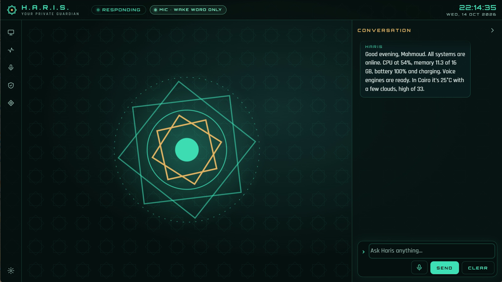

# Haris guides

**[العربية](../ar/README.md)** · [Project README](../../../README.md)

Haris is a security-first desktop AI assistant for Windows. It talks, listens and acts on your PC.
Read-only and low-risk tools run and are logged; anything that opens apps, changes files, touches the
clipboard, screen or camera, or powers off goes through an approval card you control. These guides
cover everything from the first launch to building Haris yourself.

## For users

| Guide | What it covers |
|---|---|
| [Getting started](getting-started.md) | Requirements, installing the release zip, the first launch, choosing an engine, your first conversation, uninstalling. |
| [Engines](engines.md) | Claude, Ollama, LM Studio, OpenAI-compatible clouds and Ollama on Google Colab: setup, where your data goes, model tips, the effort setting. |
| [Voice](voice.md) | Docker setup, "Hey Haris", push-to-talk, conversation mode, languages, Piper and Gemini voices, NVIDIA GPU speech-to-text, what speed to expect. |
| [Using Haris](using-haris.md) | A tour of the HUD, everything you can ask, how approvals work, the daily status report and briefing, keyboard shortcuts. |
| [Settings](settings.md) | Every field in the Settings dialog: what it does, its default and its valid values. |
| [Security and privacy](security-and-privacy.md) | The security model in plain words, what leaves your PC, where Haris keeps its files, the audit log, reporting a vulnerability. |
| [Troubleshooting](troubleshooting.md) | Real problems and their fixes: Docker, voice, GPU, Gemini limits, Colab, models, microphone, the session token, logs, resetting settings. |
| [FAQ](faq.md) | Short answers to common questions. |

## For developers

| Guide | What it covers |
|---|---|
| [Building from source](building-from-source.md) | Prerequisites, `run.ps1` and `package.ps1`, the test suites, the project layout, how the HUD gets into the jar, contributing. |

## Conventions in these guides

- Labels in **bold** are what the app shows, for example **Settings → Engine → Provider**.
- `~` means your Windows user folder, for example `C:\Users\you`. Haris keeps its own data in `~\.haris`.
- The installed app lives in `%LOCALAPPDATA%\Programs\Haris`.
- Haris's version at the time of writing is 0.6.0 (`pom.xml`).
