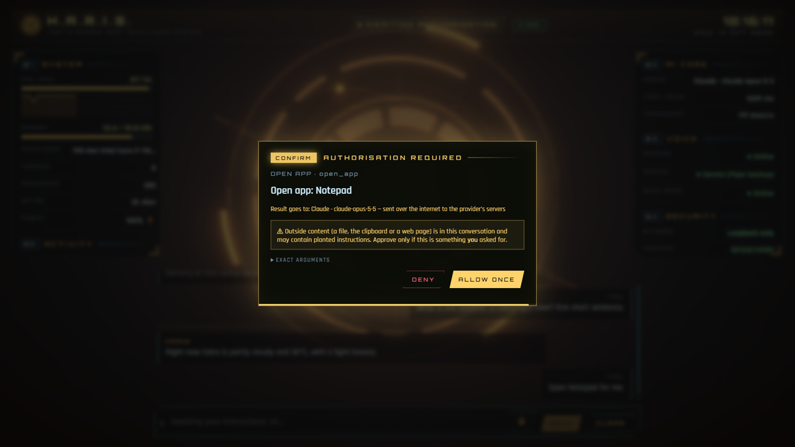

# Getting started

**[العربية](../ar/getting-started.md)** · [All guides](README.md)

This guide takes you from the release zip to your first conversation.

## What you need

| | Required? | Why |
|---|---|---|
| Windows 10 or 11 | Yes | Haris uses Windows features directly (Credential Manager, the Start menu app list, the Recycle Bin, media keys). |
| Microsoft Edge or Google Chrome | Yes | The HUD opens as an app window of Edge (preferred) or Chrome. |
| An engine (the "brain") | Yes | A local engine (Ollama or LM Studio), or an API key (Claude or an OpenAI-compatible cloud), or a free Google Colab session. See [Engines](engines.md). |
| [Docker Desktop](https://www.docker.com/products/docker-desktop/) | Optional | Runs speech-to-text (Whisper), the spoken voice (Piper) and private web search (SearXNG). Without it you can still type and read; the "Hey Haris" wake word works without Docker but nothing transcribes what you say. |
| NVIDIA GPU | Optional | Faster speech-to-text. Haris uses it automatically when Docker can reach it. See [Voice](voice.md#nvidia-gpu-speech-to-text). |
| Java | No | The installed app brings its own Java runtime. |

You need an internet connection for the first start of the Docker engines (they download their
images and speech models once) and for whatever engine you choose, unless it is local.

## Install the release

The release zip is called `Haris-<version>-windows.zip`. It contains:

| File | What it is |
|---|---|
| `Haris\` | The app itself, with its own Java runtime, the wake-word model and the Docker Compose files. |
| `install.ps1` | Installs Haris for your Windows user. |
| `uninstall.ps1` | Removes it again. |
| `haris_colab.ipynb` | The notebook for running the engine on Google Colab (optional, see [Engines](engines.md#ollama-on-google-colab)). |

1. Unzip the file anywhere, for example in your Downloads folder.
2. Right-click `install.ps1` → **Run with PowerShell**.
   If PowerShell refuses to run scripts, open PowerShell in that folder and run:
   ```powershell
   powershell -ExecutionPolicy Bypass -File install.ps1
   ```
   Add `-DesktopShortcut` to also get a desktop shortcut.
3. Start **Haris** from the Start menu.

What the installer does:

- copies the app to `%LOCALAPPDATA%\Programs\Haris` (per user, **no administrator rights**);
- checks that the copy is complete;
- creates a Start menu shortcut (and a desktop one with `-DesktopShortcut`);
- removes the program files of the older version called JARVIS, if there is one. Your old data
  in `~\.jarvis` is moved to `~\.haris` by Haris itself on its first start.

It does not touch the firewall, the registry (except later, if you turn on *Start with Windows*)
or anything outside your user profile.

### Upgrading

Close Haris, then run the new version's `install.ps1`. It replaces the program files only; your
settings, memory, reminders and keys in `~\.haris` and Credential Manager stay. One exception: a
`voice\.env` file you created inside the program folder is replaced too, so keep a copy (see
[Voice](voice.md#advanced-voice-settings)).

## The first launch

When Haris starts it:

1. starts its core on `127.0.0.1` (your PC only) with a fresh session token;
2. opens the HUD in an Edge (or Chrome) app window with its own private browser profile in
   `~\.haris\hud-profile`, so it shares no cookies, history or extensions with your normal browser;
3. starts the Docker voice and search engines, if Docker Desktop is running (it waits up to about
   two minutes for Docker to answer).

In the window you first see a short boot log:

```
H.A.R.I.S. CORE v0.6
Binding to loopback 127.0.0.1 ............ OK
Inbound network interfaces ............... NONE
Session token ............................ VERIFIED
Credential vault ......................... SEALED
Permission gate .......................... ARMED
Guardian emblem .......................... ONLINE
```

Then the HUD appears. On a fresh install no engine is set up yet, so Haris says
*"Hello, I'm Haris. Choose an engine in Settings and we can begin."* (out loud too, if the
Docker voice is running) and opens **Settings** for you.

> The first time Docker starts the voice engines it downloads the Whisper speech model and the
> Piper voice. Until that finishes, the **Voice** drawer shows the engines as **○ Offline**.

## Choose an engine

In **Settings** (gear icon at the bottom of the left rail; Arabic: **الإعدادات**):

1. Under **Engine → Provider**, pick one:

   | Provider | Use it when |
   |---|---|
   | **Ollama (local)** | You have [Ollama](https://ollama.com) installed. Nothing leaves your PC. This is the default. |
   | **LM Studio (local)** | You use LM Studio's local server. Nothing leaves your PC. |
   | **Ollama on Google Colab (free GPU)** | Your PC is too slow for a local model. Runs on Google's servers. |
   | **Claude (Anthropic API)** | You have an Anthropic API key. Handles tools and pictures (vision). |
   | **OpenAI-compatible cloud** | Any other provider with an OpenAI-style API (HTTPS). |

2. Fill in the fields that appear (URL, model, key). Keys go straight into Windows Credential
   Manager; the window can never read them back.
3. Click **Save & detect models**. Haris saves and fills the **Model** field's suggestions with
   what the engine offers. If it finds none, it says *"No models found. Is the engine running?"*
4. Pick a model and click **Save**.

The full details for each engine are in [Engines](engines.md).

While you are in Settings, it is worth filling in:

- **Your name**: Haris greets you by your first name.
- **Home city (for weather)**: used by the weather tool and the daily status report.
- **Allowed folders**: the only folders the file tools can see. By default these are your
  Desktop, Documents and Downloads folders (those that exist).

Every field is described in [Settings](settings.md).

## Your first conversation

Type in the box at the bottom (**Ask Haris anything…**) and press **Enter**
(**Shift+Enter** for a new line). Try:

- *"What's the weather today?"* (runs without asking: it only reads)
- *"How much free disk space do I have?"*
- *"Open Notepad."* (asks first)

When Haris wants to do something that changes your PC, an approval card appears:



Read it, then choose **Deny**, **Allow once** or **Allow for session**. The buttons only work
after a short moment, **Esc** denies, and the card denies by itself after two minutes.
More in [Using Haris](using-haris.md#approvals).

Everything Haris does appears in the **Activity** drawer, and many actions can be undone from
there.

## Every day after that

The first time you open Haris each day, it gives a short spoken status report (time of day, your
first name, CPU, memory, power, whether the voice engines are up, and the weather in your home
city if you set one). It is built from Haris's own readings, with no model call. Later launches that day get a
one-line greeting. If **Daily briefing** is on, a briefing from the model follows at the first
quiet moment. See [Using Haris](using-haris.md#daily-status-report-and-briefing).

## Closing Haris

Close the HUD window. About 20 seconds later (a reload does not count) the core shuts down and
stops the Docker engines it started. Nothing keeps running in the background, and the
conversation is gone: conversations are kept in memory only.

## Uninstall

Close Haris first. Then run `uninstall.ps1`, either from the release zip or from
`%LOCALAPPDATA%\Programs\Haris`:

| Command | Removes |
|---|---|
| `uninstall.ps1` | The program, its shortcuts and the *Start with Windows* entry. Your data stays in `~\.haris`. |
| `uninstall.ps1 -RemoveData` | All of the above, plus the Docker containers and their model volumes, every key Haris stored in Windows Credential Manager, and the `~\.haris` folder (settings, memory, audit log, reminders, logs, the HUD's browser profile). Also an old `~\.jarvis` folder. |

If PowerShell blocks the script, use `powershell -ExecutionPolicy Bypass -File uninstall.ps1`
(add `-RemoveData` if you want).

## Next steps

- [Engines](engines.md): pick the right brain.
- [Voice](voice.md): talk to Haris.
- [Using Haris](using-haris.md): everything you can ask.
