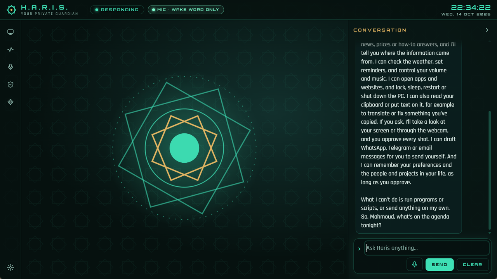
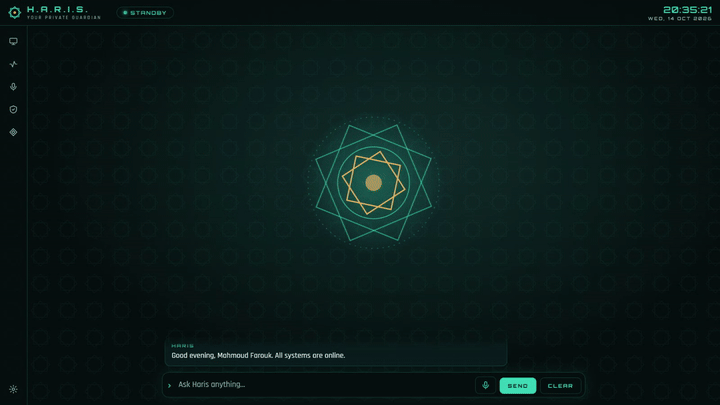

# Using Haris

**[العربية](../ar/using-haris.md)** · [All guides](README.md)

A tour of the HUD, everything you can ask Haris to do, and how approvals work.

## The HUD

### Top bar

| Part | What it shows |
|---|---|
| Brand | **H.A.R.I.S.** and *Your private guardian* (Arabic: **حارس**, *حارسك الخاص*). A custom assistant name replaces it, spelled with dots if it is one Latin word. |
| State chip | What Haris is doing (table below). |
| **MIC** badge | Visible whenever the microphone is open: **MIC**, **RECORDING**, or **MIC · WAKE WORD ONLY**. |
| **CAMERA ON** badge | Visible while the webcam is on for a photo you approved. |
| Clock | Local time and date. |

| State chip (English / Arabic) | Meaning |
|---|---|
| **STANDBY** / **جاهز** | Idle. |
| **LISTENING** / **يستمع** | Recording your voice. |
| **TRANSCRIBING** / **يحوّل الكلام إلى نص** | Turning your recording into text. |
| **PROCESSING** / **يفكّر** | Waiting for the model. |
| **RESPONDING** / **يرد** | Writing or speaking the reply. |
| **EXECUTING** / **ينفّذ** | Running a tool. |
| **AWAITING AUTHORISATION** / **بانتظار إذنك** | An approval card is open. |
| **FAULT** / **خطأ** | Something failed; the message explains. Returns to standby after a few seconds. |

### The emblem

The eight-point star in the middle mirrors the state:

| State | The emblem |
|---|---|
| Standby | The two star layers turn slowly in opposite directions around the gold core. |
| Listening | A ring pulses outwards; the core turns emerald. |
| Processing / transcribing / executing | The inner layer turns faster and the outer star turns gold. |
| Speaking | The core grows and shrinks with Haris's voice. |
| Awaiting authorisation | Motion stops and the whole emblem turns gold. |
| Fault | Motion stops and the emblem turns red. |

If Windows asks apps to reduce motion, the boot sequence is shortened.

### The rail and drawers

The icon rail on the left (on the right in Arabic) opens:

| Icon | Opens | Contents |
|---|---|---|
| Monitor | **System** drawer | CPU load with a two-minute graph, memory, processor, threads, processes, uptime, power; and the **AI core**: engine, first-token time and throughput of the last reply. |
| Pulse line | **Activity** drawer | The last six actions and the **↶ Undo** button. |
| Microphone | **Voice** drawer | **Hearing**, **Speech** and **Wake word** status. See [Voice](voice.md). |
| Shield | **Security** drawer | The security state (below). |
| Diamond | **Memory** dialog | What Haris remembers about you. |
| Gear (bottom) | **Settings** dialog | See [Settings](settings.md). |

Drawer behaviour depends on the window width:

- **Narrower than 1200 px:** a drawer floats over the stage; clicking outside it closes it.
- **1200 px and wider:** an open drawer is docked: it takes its own place and pushes the stage
  aside, so clicking elsewhere leaves it open. Close it with its rail icon, its **✕** button or
  **Esc**.
- **1600 px and wider:** the **Pin open** button appears in the drawer's header. A pinned drawer
  reopens by itself at the next launch (when the window is wide enough again).

Only one drawer is open at a time. A gold dot on the Activity or Security icon means something new
happened in a closed drawer.

### The conversation column and voice mode

- **Narrower than 1200 px:** the conversation sits under the emblem and is always visible.
- **1200 px and wider:** the conversation is a full-height column. The **›** button
  (**Hide conversation**) hides it: this is *voice mode*. Only the input box stays, floating under
  the emblem. A **Chat** tab on the edge brings the conversation back, and shows a gold dot if a new
  message arrived while it was hidden. Haris remembers your choice.

In the conversation:

- Your messages are headed **YOU**, Haris's with its name, notices and errors **SYSTEM**, and fired
  reminders **REMINDER**.
- Tool lines show what ran: **⟳** running, **✓** done, **✕** denied, **!** error.
- Every picture shared with the model appears in the conversation, captioned
  **SHARED WITH THE MODEL**.
- Model output is shown as plain text only, never as HTML.

Under the conversation: the input box (up to 8,000 characters), the microphone button, **Send**,
and **Clear** (*Forget this conversation*), which starts a fresh conversation and denies anything
still waiting for approval.

### The Activity drawer and Undo

Each of the last six actions appears with an icon:

| Icon | Decision |
|---|---|
| ◇ | Ran without asking (safe) |
| ◆ | Ran under an "Allow for session" approval |
| ✓ | You approved it |
| ✕ | Denied (by you, Esc or the timeout) |
| ↶ | Something you did yourself (an undo, a memory deletion, autostart) |

Hover an entry for the tool name, risk, decision, outcome and time. The full history is in the
audit log, `~\.haris\audit.jsonl` (see [Security and privacy](security-and-privacy.md#the-audit-log)).

**↶ Undo** reverses the most recent undoable action; the line under it says what comes next
(*Next undo: …*). Haris keeps up to 25 undo steps, in memory only (they are gone after a restart).

| Action | What Undo does |
|---|---|
| Volume up / down | Moves the volume back. |
| Restart / shut down | Cancels it (while the 60 s countdown runs). |
| Add a reminder | Cancels it. |
| Create a file | Deletes it. |
| Overwrite / append to a file | Restores the previous content. |
| Create a folder | Removes it, only if it is still empty. |
| Move / rename | Moves it back, if the old place is still free. |
| Copy to clipboard | Restores the previous clipboard text. |
| Remember a fact | Forgets it. |
| Forget a fact | Remembers it again. |

Deleting a file is not undone from Haris: it went to the Recycle Bin, so restore it from there.

### The Security drawer

| Row | Shows |
|---|---|
| **Network** | **Loopback only**: the core listens on `127.0.0.1` and nothing else. |
| **Endpoint** | The local address, for example `127.0.0.1:48213`. |
| **Session** | **Token verified**, or **NOT AUTHORISED** if the window has no session token. |
| **Keys** | **OS credential vault**: keys are in Windows Credential Manager. |
| **Tools** | **25 allow-listed**: the fixed set of tools. |
| **Context** | **Clean**, or **External content** once outside text (a file, the clipboard, a web page, a screenshot, file or app names) is in the conversation. See [Approvals](#outside-content). |

### The Memory dialog

Everything Haris remembers about you, newest first, each with its category (`preference`,
`person`, `project`, `routine` or `fact`). Hover a fact to see when it was remembered.
**✕** forgets one fact at once; **Forget everything** erases all of them after a confirmation.
Facts are encrypted on your PC (see [Security and privacy](security-and-privacy.md#memory-encryption)).

## What you can ask

Haris has 25 tools. Each has a fixed risk level that decides whether it asks first:

- **Safe**: runs without asking, and is logged.
- **Confirm**: asks with an approval card; you can allow it once or, for some tools, for the session.
- **Critical**: asks every single time.

### Apps, media and power

| Example request | Tool | Risk | Notes |
|---|---|---|---|
| "What apps do I have for photo editing?" | `list_apps` | Safe | Reads your Start menu. |
| "Open Spotify." | `open_app` | Confirm | Only apps in your Start menu, by name. If several match, Haris asks which one. |
| "Search YouTube for oud lessons." · "Open github.com." | `open_url` | Confirm | Opens your default browser. Searches on Google (default), YouTube, Bing, DuckDuckGo or Maps. Only `http(s)` links; links with a user name or password in them are refused. |
| "Turn the volume down a bit." · "Next track." · "Mute." | `media_control` | Safe | Volume steps of about 2 %; play/pause, next, previous, mute. |
| "Lock my PC." | `power` | Confirm, every time | |
| "Put the computer to sleep." · "Restart in a minute." · "Shut down." | `power` | Critical | Restart and shutdown wait 60 s and can be cancelled (Undo, or `shutdown /a`). |
| "Cancel the shutdown." | `power` | Safe | |
| "How's my battery?" · "How much free disk space do I have?" | `system_status` | Safe | CPU, memory, battery, uptime, free disk space. |

### Files (only in your allowed folders)

| Example request | Tool | Risk | Notes |
|---|---|---|---|
| "What's in my Downloads?" | `list_folder` | Safe | Up to 200 entries; hidden files are skipped. |
| "Find my invoice PDFs." | `search_files` | Safe | Searches file names, up to 50 results. |
| "Summarise notes.txt on my Desktop." | `read_file` | Safe | Text files up to 256 KB. |
| "Save this list as shopping.md in Documents." | `write_file` | Confirm | Text types only: `.txt .md .markdown .csv .tsv .json .log .yaml .yml .xml .srt`. Create (never overwrites), overwrite, or append. |
| "Make a folder called Trips in Documents." | `create_folder` | Confirm | |
| "Move report.txt to my Desktop." · "Rename it to final.txt." | `move_file` | Confirm | Never overwrites; a rename cannot change the file type. |
| "Delete old-draft.txt." | `delete_file` | Critical | Moves it to the Recycle Bin. The allowed folders themselves cannot be deleted. |

File tools never touch secrets (`.env` files, keys, `.kdbx` databases, anything named like a
password or credential, `.ssh` and similar folders), never write hidden files, and never create or
rename anything to a type Windows would run. Details in [Security and privacy](security-and-privacy.md#files).

### Clipboard, messages, reminders, weather

| Example request | Tool | Risk | Notes |
|---|---|---|---|
| "Translate what I copied." · "Fix the grammar in my clipboard." | `clipboard_read` | Confirm, every time | The clipboard can hold anything private. |
| "Put the corrected version on my clipboard." | `clipboard_write` | Confirm | Undo restores the previous text. |
| "Draft a WhatsApp to +20 100 000 0000 saying I'm late." · "Write an email to sara@example.com." | `compose_message` | Confirm | Opens a draft in WhatsApp, Telegram or your mail app. **You** press Send; Haris cannot send. |
| "Remind me in 20 minutes to call Mum." · "What reminders do I have?" | `reminders` | Safe | Add, list or cancel. Reminders pop up in the conversation and as a Windows notification while Haris is running; one missed by less than an hour is delivered at the next start. |
| "What's the weather in Alexandria?" | `weather` | Safe | Current weather and a 3-day forecast from Open-Meteo; your home city if you name none. |

### Web

| Example request | Tool | Risk | Notes |
|---|---|---|---|
| "What's the latest news about the World Cup?" | `web_search` | Safe | Through the local SearXNG engine (needs Docker). |
| "Read that article and summarise it." | `fetch_page` | Safe | Public pages only (no local network, standard ports); hidden elements removed; up to 15,000 characters of text. |

### Vision

| Example request | Tool | Risk | Notes |
|---|---|---|---|
| "What's this error on my screen?" | `look_at_screen` | Confirm, every time | Haris minimises its own window, takes **one** screenshot (main screen, or all monitors), and shows you **that exact picture** on the approval card before anything is shared. |
| "What am I holding?" | `look_through_camera` | Confirm, every time | After you approve, the camera turns on for about a second for **one** photo (the **CAMERA ON** badge shows), then off. The photo appears in the conversation. Unlike screenshots, it is not previewed before it is sent. |

Pictures are scaled to at most 1568 px on the long side and re-encoded, which removes metadata
such as location. With a local or Colab engine you need a vision model (see [Engines](engines.md#choosing-a-model)).

### Memory

| Example request | Tool | Risk | Notes |
|---|---|---|---|
| "Remember that my sister's birthday is 3 May." | `remember` | Confirm | One short fact. Passwords, codes, keys and card or account numbers are refused. |
| "What do you know about my projects?" | `recall` | Safe | Searches older facts. |
| "Forget my old address." | `forget` | Confirm | |

Haris may also *offer* to remember something; it still needs your approval.

### What Haris cannot do

- Run programs other than Start menu apps, scripts, code or shell commands. There is no such tool.
- Send a message: it only opens drafts.
- See your screen or camera without a request and an approval for each picture.
- Touch files outside the folders you allowed.

In one request Haris can take up to 12 tool steps; then it stops and says *"I stopped after 12
steps to stay on the safe side. Ask me to continue if needed."*

## Approvals

When a Confirm or Critical action comes up, Haris pauses (state **AWAITING AUTHORISATION**) and
shows a card:

| Part of the card | What it tells you |
|---|---|
| **CONFIRM** or **CRITICAL** badge | The risk level. |
| **Authorisation required** | The title. |
| Tool line | The tool's label and name, for example `OPEN APP · open_app`. |
| Summary | Exactly what will happen, for example *Open app: Spotify*, *RESTART the computer in 60 seconds*. |
| Picture | For a screenshot: the exact image that would be shared. |
| *Result goes to: …* | Which engine sees the result, and whether it stays on this computer or goes over the internet. |
| Warning | Shown when outside content is in the conversation (below). |
| **Exact arguments** | Expand to see the precise arguments the model sent. |
| Timer bar | Two minutes. |

Your choices:

| Button | Effect |
|---|---|
| **Deny** | Nothing runs. The model is told not to retry. **Deny** has the keyboard focus. |
| **Allow once** | Runs this action once. |
| **Allow for session** | Runs it, and runs this tool again without asking for the rest of the conversation. |

Rules that keep approvals honest:

- The approve buttons work only after 0.7 s, so a stray click or Enter cannot approve something
  you have not read.
- **Esc** denies. Closing the window or waiting two minutes denies too.
- Approvals come only from a click in the HUD. You cannot approve by voice (a video playing nearby
  could say "allow").
- **Allow for session** is offered only for Confirm tools, and never for reading the clipboard,
  screenshots, camera photos, power actions or deleting. Critical actions ask every time.
- A session approval lasts until the conversation restarts: **Clear**, a settings change, closing
  Haris, or a very long conversation.

### Outside content

Text Haris did not get from you (files, the clipboard, web pages and search results, screenshots
and photos, file and app names, weather place names) could contain planted instructions. Once any
of it is in the conversation:

- the Security drawer's **Context** row shows **External content**;
- **Allow for session** stops counting, and is no longer offered: every Confirm action asks again;
- actions that send data out (web search, reading a page, weather) ask too, even though they are
  normally safe, so you see the exact query or address;
- the approval card shows: *"⚠ Outside content (a file, the clipboard or a web page) is in this
  conversation and may contain planted instructions. Approve only if this is something you asked
  for."*

**Clear** starts a clean conversation.

## Daily status report and briefing

**Status report (first launch of the day).** Haris speaks and shows a report in the interface
language, composed from its own readings, with no model call:

> *Good morning, Sara. All systems are online. CPU at 12%, memory 7.9 of 16 GB, battery 80% and
> charging. Voice engines are ready. In Cairo it's 24°C with clear skies, high of 31°C.*

It waits a few seconds for the voice engines to start, uses your first name (compound names such as
"Abdel Rahman" are kept whole, titles such as "Dr." are skipped) or "sir" / «يا فندم» if you set no
name, and leaves out the weather if no home city is set. If a voice engine is down it says so, for
example *"Speech recognition is offline — is Docker Desktop running?"* Later launches that day get a
short greeting instead: *"Good afternoon, Sara. All systems are online."*

**Daily briefing** (**Settings → Identity → Daily briefing on the first launch of the day**, on by
default). Once a day, at the first quiet moment (after the status report, never during your own
request), Haris sends the model a request labelled **☀ Daily briefing**: greet you, today's date,
your reminders for today, three top headlines from one web search, and anything from memory that
matters today, in under 120 words. It uses the engine, so with a cloud engine it is a normal cloud
request. It waits until an engine is set up; if you are busy talking to Haris, it waits for a
longer pause.

## Keyboard shortcuts

| Keys | Where | Does |
|---|---|---|
| **Enter** | Input box | Send. |
| **Shift+Enter** | Input box | New line. |
| **Ctrl+Space** (hold) | Anywhere in the window | Push-to-talk: record while held. Also stops Haris speaking. |
| **Esc** | Approval card | Deny. |
| **Esc** | Open drawer | Close it (focus returns to its rail icon). |
| **Tab** | Approval card | Move between **Deny** (focused first), **Allow for session** and **Allow once**. |
