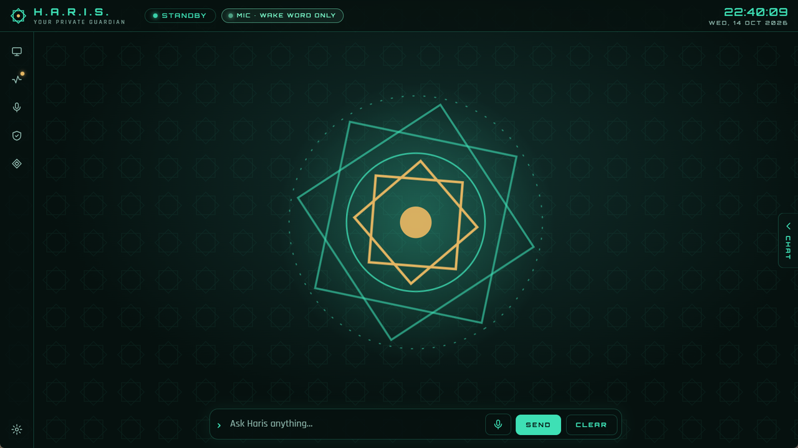

# Voice

**[العربية](../ar/voice.md)** · [All guides](README.md)

Haris can listen for "Hey Haris", transcribe what you say, and speak its replies sentence by
sentence. Everything except the optional Gemini voice runs on your PC.

## The voice engines

| Engine | Runs | Job |
|---|---|---|
| Vosk with `vosk-model-small-en-us-0.15` | Inside Haris | The wake word. No container, no network. |
| Whisper | Docker, `127.0.0.1:10300`; on your NVIDIA GPU if there is one, else the CPU | Speech to text, Arabic and English. |
| Piper | Docker, `127.0.0.1:10200` | Text to speech. Default voices `en_GB-alan-medium` and `ar_JO-kareem-medium`. |
| Gemini *(optional)* | Google, with your own key | Natural text to speech, including Egyptian Arabic. Piper takes over if it fails. |
| faster-whisper on Colab *(optional)* | Your Colab session | Speech to text, when you use the Colab engine. See [Engines](engines.md#speech-on-colab). |

The **Voice** drawer (microphone icon on the rail; Arabic **الصوت**) shows each one:
**Hearing**, **Speech** and **Wake word**, each **● Online** or **○ Offline**, plus the variants
described below.

## Set up Docker

1. Install [Docker Desktop](https://www.docker.com/products/docker-desktop/) and start it.
2. Start Haris. It runs `docker compose` on `voice/compose.yaml` and `search/compose.yaml` (the
   copies next to `Haris.exe`, or in the project folder when you run from source).
3. The first start downloads the images, the Whisper model and the Piper voice. That needs the
   internet and takes a while; the engines show **○ Offline** until they are ready.

Good to know:

- Haris waits up to about two minutes for Docker to answer at launch. If you start Docker later,
  restart Haris so it can start the engines.
- The containers start with Haris and stop when you close it, so no microphone engine keeps running
  without it.
- They are hardened: ports on `127.0.0.1` only, read-only root filesystem, all Linux capabilities
  dropped, no privilege escalation, memory and CPU limits, image versions pinned.
- Without Docker you can still type, and the wake word still works, but your speech is not
  transcribed (unless you use [speech on Colab](engines.md#speech-on-colab)) and Piper cannot speak
  (the Gemini voice can).

## Ways to talk

| How | What happens |
|---|---|
| **Hold Ctrl+Space** (push-to-talk) | Records while you hold the keys, anywhere in the Haris window. Release to send. |
| **Click the microphone** next to **Send** | Records until you stop talking. Click it again to stop early. |
| **Say "Hey Haris"** | Needs the wake-word setting (below). A short two-tone chime means Haris is listening. |

The first time, the browser asks for permission to use the microphone. Haris keeps the same local
port across launches, so the permission is remembered.

While recording:

- the state shows **LISTENING**, then **TRANSCRIBING**;
- a recording ends after about 0.6 s of quiet once you have spoken, gives up if nobody speaks for
  5 s, and stops at 15 s at most;
- recordings with no real speech (silence, clicks, room noise) are dropped before they reach
  Whisper;
- the audio is kept in memory only for the request and never written to disk.

The **MIC** badge in the top bar is visible whenever the microphone is open. It reads **RECORDING**
during a recording and **MIC · WAKE WORD ONLY** while only the wake-word engine listens.

**Barge-in:** start talking (Ctrl+Space or the microphone button) while Haris speaks and it stops
at once.

## The wake word

Turn it on in **Settings → Voice → Listen for "Hey Haris"** (off by default).

- Say a greeting directly followed by the name: **"Hey Haris"**, also "Hi", "Okay", "OK", "Ya" or
  "Yeah" + "Haris". The name alone does not wake it, because "Harris" is a common surname on TV.
- The microphone stays open, but its audio goes only to the wake-word engine inside Haris, which
  decodes only while someone is speaking. Nothing is recorded or sent anywhere.
- Haris does not listen for the wake word while it is speaking, so it never wakes itself.
- The wake word is always "Hey Haris", even if you rename the assistant.
- If the browser refuses the microphone, Haris says *"Microphone access was refused, so the wake
  word is off."*

The **Wake word** row of the Voice drawer shows **● Online** when it works, and
**○ No "hey haris" model** if the wake-word model is missing.

## Conversation mode

**Settings → Voice → Conversation mode** (on by default): after Haris answers a *spoken* request
out loud, it chimes and listens for 5 seconds for a follow-up, without the wake word. Silence ends
the conversation. Typed requests never trigger it.

## Spoken replies

**Settings → Voice → Speak replies aloud** (on by default). Haris speaks while the reply is still
being written: the first words go out as soon as there is a sensible break, then sentence by
sentence. Markdown symbols are not read out, links become the word "link" and code blocks become
"(code omitted)".

If the window has not been clicked yet and the browser blocks sound, Haris asks you to click
anywhere in the window once.

## Languages: what you speak, what Haris answers, what the HUD shows

Three separate settings:

| Setting | Values | Affects |
|---|---|---|
| **I speak** (`sttLanguage`) | **Detect automatically**, **Arabic (best for Egyptian Arabic)**, **English** | What language Whisper expects. Choose Arabic if you speak Egyptian Arabic. |
| **Haris replies in** (`replyLanguage`) | **The language I use**, **Egyptian Arabic, always**, **English, always** | The language the model is told to answer in. Arabic replies are in Egyptian Arabic (Masri). |
| **Interface language** (`uiLanguage`) | **English**, **العربية** | The HUD's own words and layout (Arabic is right-to-left), and the language of the greeting and status report. |

You can, for example, keep the interface in English and have Haris always answer in Egyptian Arabic.

## Piper voices

| Setting | Default |
|---|---|
| **Piper English voice** | `en_GB-alan-medium` |
| **Piper Arabic voice** | `ar_JO-kareem-medium` |

Haris uses the Arabic voice for any sentence that contains Arabic letters and the English voice
for the rest. Any Piper voice name in the form `xx_YY-name-quality` (quality `x_low`, `low`,
`medium` or `high`) is accepted; Piper downloads a new voice the first time it is used. Check each
voice's licence before commercial use (see [THIRD_PARTY_NOTICES.md](../../../THIRD_PARTY_NOTICES.md)).

**▶ Test speaker** in Settings plays one English and one Arabic test sentence.

## Gemini voice

A more natural voice, including Egyptian Arabic, from Google's Gemini text-to-speech
(`gemini-3.8-flash-tts`).

1. Get a key at [aistudio.google.com](https://aistudio.google.com) → **Get API key**.
2. In **Settings → Voice**, set **Voice engine** to **Gemini — natural, Egyptian Arabic (reply text
   goes to Google)**.
3. Paste the key into **Google AI Studio key** and pick a **Gemini voice** (30 prebuilt voices;
   default **Charon**).
4. Click **Save**. The hint reads *"A Google key is saved in Windows Credential Manager. Gemini
   speaks; Piper takes over if it fails."*

What to know:

- **Every sentence Haris speaks is sent to Google as text**, including the greeting and status
  report. Your voice is not sent: speech-to-text stays local.
- Arabic sentences are spoken with an Egyptian accent; English ones in a clear, warm style.
- **Limits and fallback.** If Google answers with a rate limit (often the free daily quota), Piper
  speaks until the time Google gives, and the Voice drawer shows
  **● Piper (Gemini limit, back HH:MM)**. Any other Gemini error makes Piper speak for the next
  minute. Piper therefore needs to be running (Docker) as a backup.
- The **Speech** row shows **● Gemini**, or **● Gemini (Piper backup)** when Piper is also up.
- Without a saved key, Piper speaks even if Gemini is selected.

## NVIDIA GPU speech-to-text

With an NVIDIA GPU, Whisper can run on it: on the author's laptop (MX450, 2 GB) a short phrase took
about 1.0 s on the GPU instead of about 1.5 s on the CPU, using about 0.4 GB of video memory.

### Requirements

Haris uses the GPU automatically when all of these hold:

- Docker Desktop lists the `nvidia` runtime (`docker info`);
- `nvidia-smi -L` on Windows lists a GPU;
- `voice/compose.gpu.yaml` is present (it ships with Haris);
- Docker Compose is version 2.24.4 or later (`docker compose version`);
- `HARIS_WHISPER_GPU` is not switched off (below).

### What happens

1. **First launch with a GPU:** the GPU image (`lscr.io/linuxserver/faster-whisper`, several GB)
   is not on your PC yet. Haris starts Whisper on the **CPU** right away and downloads the GPU
   image in the background. Progress is written to the log. A download cut short continues at the
   next start.
2. **Next launch:** Whisper starts on the GPU, from `voice/compose.yaml` plus `voice/compose.gpu.yaml`.
   Same port and hardening as the CPU container, except the GPU device, the image, a separate model
   volume and a 3 GB memory cap.
3. The **Hearing** row shows **● Online (GPU)**.

### Fallback

- If the GPU container does not answer within about 90 seconds (longer while it is still
  downloading its model), Haris switches to the CPU container by itself.
- It then remembers the failure in `~\.haris\whisper-gpu-failed` and starts on the CPU for three
  days (or until the GPU image changes). Delete that file to try the GPU again sooner.
- With a Docker Compose older than 2.24.4, Haris stays on the CPU and does not download the image.

### Switching the GPU off

Set `HARIS_WHISPER_GPU=false` to always use the CPU (`0`, `no`, `off` and `cpu` work too), either
as a Windows environment variable or as a line in `voice/.env`. The environment variable wins.

## Advanced voice settings

The voice containers read optional settings from `voice/.env`. Start from
[`voice/.env.example`](../../../voice/.env.example):

| Where | Path |
|---|---|
| Installed app | `%LOCALAPPDATA%\Programs\Haris\voice\.env` |
| From source | `voice\.env` in the project folder |

| Variable | Default | What it does |
|---|---|---|
| `WHISPER_MODEL` | `small-int8` | CPU speech model: `tiny-int8` (fastest), `base-int8`, `small-int8` (good Arabic), `medium-int8` (best, slow on a CPU). |
| `HARIS_WHISPER_GPU` | on | `false` keeps speech-to-text on the CPU. |
| `WHISPER_GPU_MODEL` | `small` | GPU speech model. |
| `WHISPER_GPU_COMPUTE` | `int8_float16` | GPU precision. `small` with `int8_float16` fits a 2 GB GPU. |
| `WHISPER_OFFLINE` | `false` | `true` forbids the Whisper containers (CPU and GPU) from downloading anything. Set it after the first successful start. |
| `PIPER_VOICE` | `en_GB-alan-medium` | The voice Piper loads at start. Other voices load on request. |

Restart Haris after editing. Two cautions:

- Upgrading Haris replaces the program folder but keeps your `voice\.env` (the installer saves it
  and puts it back). Uninstalling removes it with the program folder. You can also set the
  variables as Windows user environment variables instead (Docker Compose reads those too, and
  they take precedence over `.env`).
- Changing `WHISPER_MODEL` downloads the new model on the next start, unless `WHISPER_OFFLINE=true`.

## How fast is it?

From measurements on a laptop CPU (i7-1165G7):

- Whisper takes roughly 3–4 s for a typical request; a short phrase about 1.5 s on the CPU and
  about 1.0 s on an MX450 GPU.
- The first spoken sentence starts roughly 1.5–2.5 s after the reply begins.
- Add the model's own time, which depends on the engine.

Right after launch the first request can be slower: Whisper may still be loading its model, and
Haris waits up to 90 seconds for the engines to finish starting rather than losing your words.

Faster options: a GPU, speech-to-text on Colab, a smaller `WHISPER_MODEL` (`base-int8`), and
Claude's **Low** effort.
